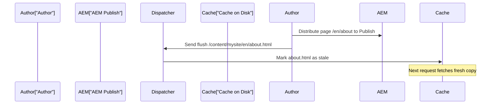

# Dispatcher & Caching

The Dispatcher is a **caching and load-balancing** layer that sits in front of AEM Publish instances. It is the first
line of defense for performance and security. In AEMaaCS, the Dispatcher runs on Apache HTTP Server with a custom
module.

## Architecture


In AEMaaCS, the flow is:

1. **Adobe-managed CDN** - first cache layer
2. **Dispatcher** - Apache + Dispatcher module. Second cache layer
3. **AEM Publish** - renders the page if not cached

Most requests should be served from CDN or Dispatcher cache, never reaching Publish.

### What the Dispatcher does

| Function           | Description                                   |
|--------------------|-----------------------------------------------|
| **Caching**        | Stores rendered HTML, images, CSS, JS on disk |
| **Filtering**      | Blocks malicious or unnecessary requests      |
| **Load balancing** | Distributes requests across Publish instances |
| **URL rewriting**  | Maps vanity URLs and redirects                |
| **Security**       | Blocks access to sensitive paths              |

## Dispatcher configuration in your project

The Dispatcher config lives in the `dispatcher/` module:

```text
dispatcher/
└── src/
    ├── conf.d/
    │   ├── available_vhosts/
    │   │   └── default.vhost         # Virtual host configuration
    │   ├── enabled_vhosts/
    │   │   └── default.vhost -> ...  # Symlink to enable
    │   ├── rewrites/
    │   │   └── rewrite.rules         # URL rewrite rules
    │   └── variables/
    │       └── custom.vars           # Custom variables
    └── conf.dispatcher.d/
        ├── available_farms/
        │   └── default.farm          # Farm configuration
        ├── enabled_farms/
        │   └── default.farm -> ...   # Symlink to enable
        ├── cache/
        │   └── rules.any             # Cache rules
        ├── clientheaders/
        │   └── clientheaders.any     # Forwarded headers
        ├── filters/
        │   └── filters.any           # Request filters
        └── renders/
            └── default_renders.any   # Publish instance addresses
```

## Cache rules

Cache rules decide which responses the Dispatcher stores on disk. The rule set and the full list of conditions a
response must meet (status, method, cookies, auth, query strings) live in the [Dispatcher Configuration
reference](/aem/infrastructure/dispatcher-configuration#cache-rules).

## Filters

Filters control which requests reach AEM: they run before the cache, so a denied request never reaches Publish. The
deny-by-default rule set and the common-paths table live in the [Dispatcher Configuration
reference](/aem/infrastructure/dispatcher-configuration#filter-rules).

### Filter order matters

Filters are evaluated **top to bottom** and the **last matching rule wins** (not the first). Because of that
last-match semantics, the position of your deny rules relative to allow rules is critical: a deny rule placed before
an allow will be overridden by that allow. That is why the recommended pattern starts from a deny-all baseline and
allows explicit delivery paths before denying sensitive paths.

> **Security:** Always deny access to `/crx/*`, `/system/console/*`, and other admin paths on Publish.

## URL rewrites

Rewrite rules map vanity URLs and handle redirects. The full rule examples (content path shortening, `.html`
extension, trailing-slash normalisation) live in the [Dispatcher Configuration
reference](/aem/infrastructure/dispatcher-configuration#rewrite-rules).

### Vanity URLs

AEM supports vanity URLs in page properties. An author can set `/products` as a vanity URL for
`/content/mysite/en/products-and-services`. The Dispatcher resolves these through a vanity URL mapping file.

## Cache invalidation

When content is published, the Dispatcher cache must be updated. AEM handles this through configured Dispatcher Flush
agents on 6.5/AMS and through Adobe-managed invalidation on AEMaaCS.

### Auto-invalidation

When a page is published, AEM sends an invalidation request to the Dispatcher. The Dispatcher marks the cached file (and
potentially related files) as **stale**:



### Stat file invalidation

The Dispatcher uses a `.stat` file mechanism for age-based invalidation:

1. When a page is published on AEM 6.5, a **Dispatcher Flush agent** (typically configured on Author) sends an HTTP
   invalidation request to the Dispatcher. In AEMaaCS, Adobe manages the distribution and invalidation flow.
2. The Dispatcher **touches** (updates the timestamp of) the `.stat` file in the relevant cache directory
3. On the next request, the Dispatcher compares the cached file's timestamp against the `.stat` file
4. If the cached file is **older** than `.stat`, it is considered stale and re-fetched from Publish
5. If the cached file is **newer** than `.stat`, it is served directly from cache

### Stat file level

The `statfileslevel` setting controls how broadly invalidation spreads: the higher the level, the more granular the
invalidation. The full level table and tuning guidance live in the [Dispatcher Configuration
reference](/aem/infrastructure/dispatcher-configuration#statfileslevel).

## Local Dispatcher testing with the SDK

The AEMaaCS SDK includes a Dispatcher SDK for local testing.

### Setup

1. Download the Dispatcher SDK from the Software Distribution portal
2. Extract it alongside your AEM SDK
3. The SDK includes Docker-based tools for running the Dispatcher locally

### Validate configuration

```bash
# From the dispatcher SDK directory
./bin/validator full dispatcher/src
```

This validates your Dispatcher configuration against AEMaaCS rules. Common checks:

- No deprecated directives
- No hardcoded IPs
- All includes resolve
- Filters follow security best practices

### Run locally

```bash
# Start the local Dispatcher (Docker required)
./bin/docker_run.sh dispatcher/src host.docker.internal:4503
```

This starts an Apache + Dispatcher instance pointing to your local Publish on port 4503. Test at
`http://localhost:8080`.

### AEMaaCS Dispatcher restrictions

In AEMaaCS, the Dispatcher configuration is **partially immutable**. Adobe manages the base Apache/Dispatcher
configuration, and your project can only customize specific areas:

| Allowed                                                  | Not allowed                                                   |
|----------------------------------------------------------|---------------------------------------------------------------|
| Custom virtual hosts in `conf.d/available_vhosts/`       | Custom Apache modules (`LoadModule`)                          |
| Rewrite rules in `conf.d/rewrites/`                      | Modifying `httpd.conf` or `dispatcher.any` directly           |
| Custom filters in `conf.dispatcher.d/filters/`           | Changing the render address (managed by Adobe)                |
| Cache rules in `conf.dispatcher.d/cache/`                | Adding `AllowOverride` or `.htaccess` files                   |
| Custom variables in `conf.d/variables/`                  | Inline PHP, CGI, or other scripting modules                   |
| Client headers in `conf.dispatcher.d/clientheaders/`     | Directives that conflict with Adobe's base configuration      |

The Dispatcher SDK validator (`./bin/validator full`) enforces these restrictions locally. Always validate before
pushing to Cloud Manager - the pipeline will reject invalid configurations.

### Testing checklist

| Test              | What to verify                                      |
|-------------------|-----------------------------------------------------|
| **Page loads**    | Pages render correctly through the Dispatcher       |
| **Caching**       | Reload and check the `X-Dispatcher` response header |
| **Filters**       | Admin paths return 403 or 404                       |
| **Rewrites**      | Vanity URLs resolve correctly                       |
| **Invalidation**  | Publish a page and verify the cache is refreshed    |
| **Static assets** | CSS, JS, images served with proper cache headers    |

### Troubleshooting quick guide

| Symptom                               | First check                                | Typical fix                                                |
|---------------------------------------|--------------------------------------------|------------------------------------------------------------|
| Unexpected 403 via Dispatcher         | `filters.any` order and last-match behavior | Add explicit allow for required path before deny selectors |
| Cache never hits                      | Response headers and cache rules            | Remove non-cacheable headers where appropriate, adjust rules |
| Content stale after publish           | Invalidation logs and `statfileslevel`      | Verify flush agent flow and tune invalidation granularity  |
| Vanity URL fails                      | Rewrite/vanity mappings and vhost            | Rebuild mappings and validate rewrite conditions            |
| Works direct publish, fails on CDN    | CDN cache/headers and dispatcher response    | Align cache headers and purge strategy                      |

> For detailed configuration, see the [Dispatcher Configuration](/aem/infrastructure/dispatcher-configuration)
> reference. See also [Performance](/aem/infrastructure/performance) for broader optimization strategies
> and [Security Basics](/aem/infrastructure/security) for hardening your Publish tier.

## Summary

You learned:

- **Dispatcher architecture** - CDN > Dispatcher > Publish
- **Cache rules** - what gets cached and what does not
- **Filters** - blocking malicious requests, allowing legitimate ones
- **URL rewrites** - vanity URLs and redirects
- **Cache invalidation** - stat files, auto-invalidation on publish
- **Stat file level** - controlling invalidation granularity
- **Local testing** with the Dispatcher SDK

## Official Documentation

- [AEM as a Cloud Service Dispatcher](https://experienceleague.adobe.com/en/docs/experience-manager-cloud-service/content/implementing/content-delivery/disp-overview) - configuration in the cloud
- [Dispatcher in the Cloud (overview)](https://experienceleague.adobe.com/en/docs/experience-manager-cloud-service/content/implementing/content-delivery/overview) - CDN, Dispatcher, Publish layering
- [Caching with the CDN](https://experienceleague.adobe.com/en/docs/experience-manager-cloud-service/content/implementing/content-delivery/caching) - cache headers and TTLs
- [Dispatcher Configuration tool & validator](https://experienceleague.adobe.com/en/docs/experience-manager-cloud-service/content/implementing/content-delivery/validation-debug) - local SDK testing

Next up: [Security & Permissions](./19-security-and-permissions.md) - users and groups, ACLs and permission
inheritance, closed user groups, service users, and hardening the publish tier.
