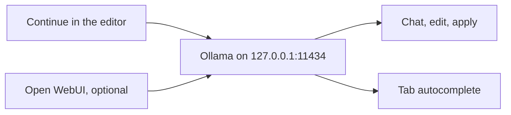
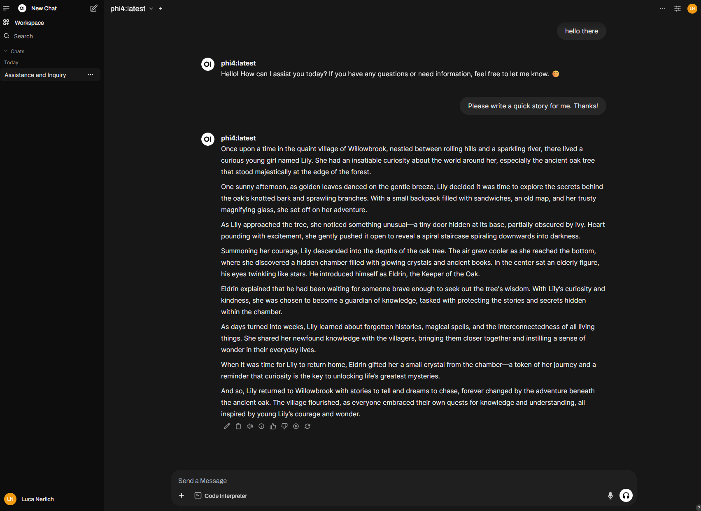
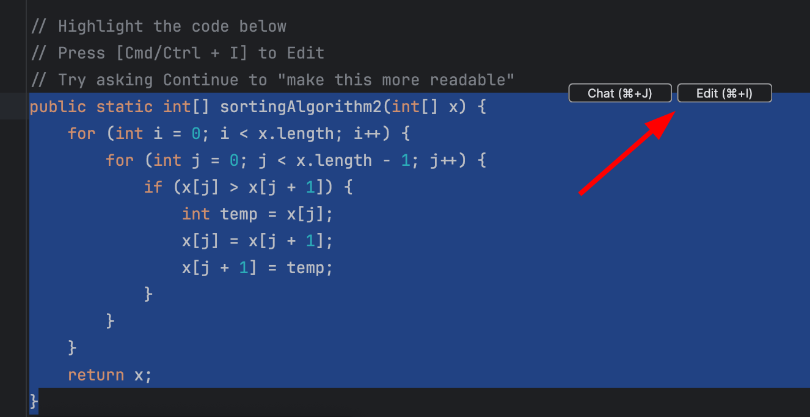
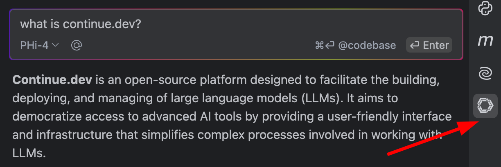

# How to set up a local & offline coding assistant

This guide sets up a local **coding assistant** inside your editor. The model runs on your machine, so
there is no API key and the assistant still works when the network does not.

If you want to call a local model from your own app, see [Build a Local LLM App](./local-llm-app.md).
For when local is the wrong tool, see [Cloud vs Local Models](./cloud-vs-local.md).



One Ollama server feeds every client. Continue is the editor integration. Open WebUI is an optional
browser chat in front of the same models. A second Ollama inside Docker gives the editor and the
browser two different model lists.

## What you are wiring up

A coding assistant is three jobs, and they should not share one model.

| Job | What it does | What to run |
|---|---|---|
| Chat, edit, apply | Sidebar chat, inline edits, and merging a change into the file | The largest **coding** model that stays on the GPU |
| Tab autocomplete | A suggestion while you type | A small fill-in-the-middle model, about 1 GB |
| Retrieval | Embeddings and reranking for an old-style codebase index | Skip it on a new setup. Details below |

Autocomplete models are trained on a fill-in-the-middle prompt: the code before the cursor, the code
after it, and a hole to complete. A chat model, including a strong one, answers in the wrong shape and
is too slow to sit on the keystroke path. Continue's autocomplete guide still names
[Qwen2.5-Coder 1.5B and 7B](https://docs.continue.dev/customize/deep-dives/autocomplete) for this, and
tells you to keep thinking models off that role.

The apply role is the model that writes an edit back into the file. Point it at the chat model. The
1.5B autocomplete model produces bad patches.

## What local coding can do

[Vicki Boykis, 15 June 2026](https://vickiboykis.com/2026/06/15/running-local-models-is-good-now/),
on a 2022 M2 Mac with 64 GB of RAM: agentic loops on Gemma 4 ran at about **75% the accuracy and speed
of frontier models**, by her own check, which is whether she still had to diff the answer against an
API model. She used `gemma-4-26b-a4b` in LM Studio as the default, and she was impressed by
`gemma-4-12b-qat` for the speed you get at that size. Earlier she had used Qwen 3 MoE, Qwen 2.5 Coder,
and GPT-OSS. The tasks were real and modest: turn a notebook into a few typed modules, write unit
tests, bootstrap a small repo. She also wrote the caveat that matters: she was not ready to call it
production software development. Her harness was Pi against LM Studio, sandboxed in Docker, not
Continue. The KV cache on those sessions grew until it filled the 64 GB machine.

That report is still the right expectation in October 2026. Local models are good enough for daily
private work: edits, tests, refactors, "how does this file work". They are slower than a hosted API,
the context window is whatever your RAM can hold, and a tricky bug still deserves a second pass. Pull
a current tag, then judge it on your repo.

Model names below were checked against the [Ollama library](https://ollama.com/library) on 13 October 2026.
Tags move. Pull an explicit tag, then re-read the model card when a result smells wrong.

A few naming traps:

- `ollama pull gemma4` tracks `:latest`, which is the small **E4B** model (6.6-9.5 GB), not the 26B.
- `ollama pull qwen3.5` tracks the **9B** tag, not the 27B or the 397B model from Qwen's marketing table.
- `ollama pull qwen3-coder` currently tracks the **30B** tag (19 GB). The 480B tag is `qwen3-coder:480b`
  (290 GB, and Ollama asks for at least 250 GB of memory). Do not pull it to "see what happens".
- `qwen3:30b-a3b` is the general Qwen 3 mixture-of-experts model. The coding model is `qwen3-coder:30b`.
  They are not interchangeable.
- Qwen's published comparison tables for Qwen3.5 are the **397B-A17B** model. They do not describe
  `qwen3.5:9b` or `qwen3.5:27b`.

Phi-4 (`phi4`) is what an older revision of this page recommended for general chat. It still runs, and
the weights are MIT-licensed, but it is no longer the model to pull first.

## Pick a model that fits

Download size is the weight file. It is not the whole memory bill. The [KV cache](./glossary.md#context-window)
grows with every token you keep in context, and the autocomplete model sits in memory next to the chat
model. If `ollama ps` shows the processor spilling onto CPU, the model is too big for the context you
asked for, even when the download "fit".

Mixture-of-experts models are the practical trick. `gemma4:26b` is 25.2B parameters with **3.8B active**.
`qwen3-coder:30b` is 30B parameters with **3.3B active**. You download the full file, and you pay
compute for the active slice, which is why these feel faster than a dense model of the same file size.
`gemma4:31b` is dense (about 31B, all of them active). Google's card has it a bit ahead of the 26B
mixture-of-experts model on coding benchmarks and slower to generate. Read those numbers on the
[Gemma 4 model card](https://ollama.com/library/gemma4), not as a promise about a 4-bit file inside Continue.

Budget the **top** of each range. Ollama prints a range when a tag covers more than one quantization.

| Memory you can give the model | Chat model | Tag | Download | Max context on the card |
|---|---|---|---|---|
| 8 GB VRAM, or a tight 16 GB laptop | Gemma 4 E4B, or Qwen3.5 4B if that spills | `gemma4:e4b` or `qwen3.5:4b` | 6.6-9.5 GB, or 3.3-4.0 GB | 128K / 256K |
| 16 GB VRAM, or about 32 GB unified | Gemma 4 12B or Qwen3.5 9B | `gemma4:12b` or `qwen3.5:9b` | about 8 GB, or 6.6-7.6 GB | 256K |
| 24 GB VRAM, or 64 GB unified | Qwen3-Coder 30B or Gemma 4 26B | `qwen3-coder:30b` or `gemma4:26b` | 19 GB, or 16-19 GB | 256K |
| 64 GB and you want a denser Gemma | Gemma 4 31B | `gemma4:31b` | 19-20 GB | 256K |
| The 30B coder is the bottleneck, and you still have room | Qwen3-Coder-Next (80B, 3B active) | `qwen3-coder-next` | about 52 GB at Q4 | 256K |

The context column is the model's maximum, not what Ollama will allocate. On anything under 24 GB of
VRAM the default allocation is 4k tokens. See [Context is the real limit](#context-is-the-real-limit).

Always pull a tab model as well:

```bash
ollama pull qwen2.5-coder:1.5b
```

That tag is about 1 GB, with a 32K context, and it is fill-in-the-middle trained. Step up to
`qwen2.5-coder:7b` (about 4.7 GB) only when the 1.5B suggestions are too shallow **and** `ollama ps`
still shows the chat model fully on GPU. Qwen2.5-Coder is an older family. For tab-complete that is
fine: the job is latency and prompt shape, not a SWE-bench score.

On a 24 GB GPU or a 64 GB Apple Silicon machine, the daily pair is `qwen3-coder:30b` (or `gemma4:26b`
if you want Gemma's vision and the model Boykis ran) plus `qwen2.5-coder:1.5b`. On a 16 GB machine,
start with `gemma4:12b` or `qwen3.5:9b`. Gemma 4 12B is the closest Ollama tag to the 12B QAT build
she liked; the tag is about 8 GB.

Apple Silicon also has `-mlx` tags (`gemma4:26b-mlx`, and the same pattern for the other Gemma 4 and
Qwen3.5 sizes). The plain tags already run on Apple Silicon. Pull an `-mlx` tag when you specifically
want Ollama's MLX runner.

### Licenses

Check the card before you redistribute weights or ship a product on top of them.

- Qwen2.5-Coder is [Apache-2.0](https://huggingface.co/collections/Qwen/qwen25-coder-66eaa22e6f99801bf65b0c2f).
- Qwen3.5's Ollama card includes Apache-2.0. Confirm `qwen3-coder` on its card too; do not assume every
  Qwen tag shares a license.
- Gemma 4 is under the [Gemma Terms of Use](https://ai.google.dev/gemma/terms), including a prohibited-use
  policy. That is not Apache-2.0 or MIT.
- `nomic-embed-text`, if you still need embeddings, is Apache-2.0.

## Install Ollama and Continue

1. Install [Ollama](https://ollama.com/download). The desktop app starts the server. On a headless
   machine, run `ollama serve` yourself.
2. Install Continue for [VS Code](https://marketplace.visualstudio.com/items?itemName=Continue.continue)
   or [JetBrains](https://plugins.jetbrains.com/plugin/22707-continue).
3. Confirm the server is local before you pull anything:

```bash
curl -s http://127.0.0.1:11434/api/version
```

A JSON version string means you are talking to Ollama. `connection refused` means the app is not
running, or it is bound somewhere else.

:::warning
Keep Ollama, LM Studio, and Open WebUI on localhost unless you have added authentication and a network
control. Ollama binds to `127.0.0.1:11434` by default. `OLLAMA_HOST=0.0.0.0:11434` publishes an API
with no auth. LM Studio API tokens are off until you enable them. Open WebUI authentication defaults
to on (`WEBUI_AUTH=True`); do not set `WEBUI_AUTH=False` on a shared or exposed instance. The longer
note is in [Build a Local LLM App](./local-llm-app.md#security-localhost-is-not-an-auth-boundary).
:::

LM Studio is a reasonable server if you would rather download models in a GUI. Boykis ran Gemma that
way. The model choice above does not change. Point Continue at
`http://127.0.0.1:1234/v1` with `provider: openai` and any non-empty `apiKey` (LM Studio ignores it
until you turn authentication on; then use the real token). Setup for the server itself is in
[Build a Local LLM App](./local-llm-app.md).

Ollama can also launch other harnesses against a local tag, for people who already live in those
tools:

```bash
ollama launch opencode --model qwen3-coder:30b
ollama launch claude --model qwen3-coder:30b
```

Those commands come from the [Qwen3-Coder model card](https://ollama.com/library/qwen3-coder). The
rest of this page is the Continue setup.

## Pull the models

Pull **one** chat model from the table, plus the autocomplete model. Pulling every row fills the disk
and does not make Continue smarter.

Workstation (24 GB VRAM, or 64 GB unified):

```bash
ollama pull qwen3-coder:30b
ollama pull qwen2.5-coder:1.5b
```

16 GB-class machines, swap the chat tag:

```bash
ollama pull gemma4:12b
ollama pull qwen2.5-coder:1.5b
```

Smoke-test the small model before you blame the editor. This exits on its own:

```bash
ollama run qwen2.5-coder:1.5b "Write a one-line Python function that adds two numbers."
ollama ps
```

`ollama ps` is the page you will keep coming back to. `PROCESSOR` should say `100% GPU`. `CONTEXT` is
the window Ollama allocated, which is often much smaller than the model card.

## Quantization, in practice

[Quantization](./glossary.md#quantization) stores the weights in fewer bits so a 30B model fits in a
gaming GPU. You do not pick a bit width for a normal `ollama pull`. Library tags are already quantized
GGUF files. When the repo includes it, the usual default is **Q4_K_M**, a 4-bit K-quant.
That is the right default for coding. The background, including QLoRA, is in
[Cloud vs Local Models](./cloud-vs-local.md#quantization-and-qlora).

What is worth knowing when you code against one:

- A Q4 file is a different model than the benchmark you read. Vendor tables are full-precision
  instruct models under their own harness. Expect a gap, then judge the tag you pulled.
- Dropping to Q2 or Q3 to force a model onto a small GPU usually hurts coding more than switching to
  a smaller model at Q4. Prefer `gemma4:12b` or `qwen3.5:9b` over a crushed 30B.
- Q8 and FP16 tags exist for when you have memory left and a measured quality problem. They are not
  the first pull.
- Some Qwen tags use NVFP4 (`qwen3.5:35b-a3b-coding-nvfp4` is one). That format wants a GPU that
  implements it. Skip it unless you know the card supports it.
- Mixture-of-experts quantization still stores every expert. The 19 GB Qwen3-Coder download is the
  full 30B, not the 3.3B active slice.

## Context is the real limit

The model card saying 256K does not mean your session has 256K.

Ollama's [context-length doc](https://docs.ollama.com/context-length) sets the default from VRAM
(checked October 2026):

| VRAM | Default context |
|---|---|
| Under 24 GiB | 4k |
| 24-48 GiB | 32k |
| 48 GiB and up | 256k |

The [FAQ](https://docs.ollama.com/faq) still describes 4096 as the default, and it notes that required
RAM scales with `OLLAMA_NUM_PARALLEL` times the context length. When the FAQ and the context-length
page disagree, `ollama ps` matches the running server. Leave the parallel slot count alone on a laptop.
The context-length page says coding tools and agents should be set to **at least 64k**. Take that as a
target, not a command. A 19 GB model on a 24 GB card does not have 64k of KV cache left over, and the
autocomplete model needs a slice too.
The formula and a worked example are in [Serving LLMs at Scale](./llm-serving.md#kv-cache-memory-sizing).
The knobs (`OLLAMA_CONTEXT_LENGTH`, API `num_ctx`, Modelfile `PARAMETER num_ctx`, KV cache type) are
in [Build a Local LLM App](./local-llm-app.md#context-length-and-memory).

For Continue, set the window on the model or you will hit one of two failures:

- The window stays at Ollama's default (often 4k on a smaller GPU). The agent "forgets" the file you
  attached because the repo map ate the budget.
- Continue asks for more context than you have, and you get **Model requires more system memory**.
  Their [Ollama guide](https://docs.continue.dev/customize/model-providers/top-level/ollama) says to
  lower `defaultCompletionOptions.contextLength`.

Start at `16384` on a 16 GB machine and `32768` on a 24 GB GPU or 64 GB unified machine. Send a real
edit, run `ollama ps`, and raise the number only while `PROCESSOR` stays `100% GPU`. If generation
crawls, step back. A fast 16k window beats a 64k window that has fallen onto the CPU.

Gemma 4's card asks for `temperature=1.0`, `top_p=0.95`, `top_k=64`, and Ollama ships those sampling
params with the tag. Leave them alone unless you are running a comparison. A second temperature in
Continue fights the model file.

## Continue config

- Unix: `~/.continue/config.yaml`
- Windows: `%USERPROFILE%\.continue\config.yaml`

Reload the editor window after you save it. Then open Continue's model picker (the cube icon in the
panel) and set the active model for **Chat**, **Edit**, **Apply**, and **Autocomplete**. A model
listed in the file is not automatically the one on the keystroke path.

This config matches the workstation pull (`qwen3-coder:30b`). If you pulled `gemma4:12b` instead,
change the `model` value and drop `contextLength` to `16384`. Delete any block you have not pulled,
or Continue will offer a model that 404s.

```yaml title="~/.continue/config.yaml"
name: Local Ollama
version: 0.0.1
schema: v1

models:
    -   name: Qwen3-Coder 30B
        provider: ollama
        model: qwen3-coder:30b
        roles:
            - chat
            - edit
            - apply
        defaultCompletionOptions:
            contextLength: 32768
    -   name: Qwen2.5-Coder 1.5B
        provider: ollama
        model: qwen2.5-coder:1.5b
        roles:
            - autocomplete
        autocompleteOptions:
            debounceDelay: 250
            maxPromptTokens: 1024
            onlyMyCode: true

rules:
    - Always respond in English.
    - Always provide clear, concise, and accurate answers.
    - Support a software developer with explanations, code, best practices, and debugging help.
    - Prefer the libraries and patterns already in the repo. Say so before adding a dependency.
    - When you are unsure, say what you checked and what is still a guess.

prompts:
    -   name: test
        description: Generate unit tests for the highlighted code.
        prompt: |
            Write unit tests for the provided code. Include setup, the correctness checks that matter, the edge cases that are likely to fail, and teardown. Present the tests as plain text.
    -   name: refactor
        description: Improve the code's structure for better readability.
        prompt: |
            Refactor the provided code to improve its structure and readability without altering its functionality. Include a detailed explanation of your changes and reasoning.
    -   name: optimize
        description: Enhance code performance with a detailed explanation of changes and trade-offs.
        prompt: |
            Optimize the provided code for performance while maintaining its current behavior. Describe any trade-offs involved in your optimization process.
    -   name: explain
        description: Analyze and explain the code's functionality and potential improvements.
        prompt: |
            Explain the logic and functionality of the provided code. Discuss any potential inefficiencies or unnecessary computations that could be improved for better performance.
    -   name: document
        description: Create clear and concise function documentation using the correct language format.
        prompt: |
            Write language-specific documentation for the provided function. Use appropriate formats like Javadoc for Java or JSDoc for JavaScript. Ensure clarity and conciseness in your explanation.

context:
    -   provider: diff
    -   provider: file
    -   provider: code
    -   provider: currentFile
    -   provider: terminal
    -   provider: open
    -   provider: repo-map
    -   provider: tree
    -   provider: problems
    -   provider: os
```

`onlyMyCode: true` keeps autocomplete out of `node_modules` and other dependencies. The debounce and
prompt cap keep the 1.5B model from stalling the editor. Continue's own Codestral example uses a
150 ms model timeout; that is for a hosted API. A local model on CPU will miss that deadline, so this
config does not set `modelTimeout`.

If you point autocomplete at a thinking model anyway (Qwen3, Gemma 4, Qwen3.5), turn thinking off or
the suggestion arrives late and full of scratchpad tokens:

```yaml
requestOptions:
    extraBodyProperties:
        think: false
```

That key is the one [Continue documents](https://docs.continue.dev/customize/deep-dives/autocomplete)
for a thinking-switchable Ollama model. The 1.5B coder tag does not need it.

### Rules and documentation

Global rules in `config.yaml` apply on every project. Project rules belong in the repo, under
`.continue/rules/`, so they review and travel with the code. Continue loads those files in agent,
chat, and edit. The same idea, across editors, is covered in
[Project Memory & Rules](./project-memory-and-rules.md).

```markdown title=".continue/rules/project.md"
# Repo

Match the style of the file you are editing.
Read AGENTS.md, or the nearest project-memory file, before changing the build.
Do not add a dependency, a workflow, or a config knob that the repo does not already use.
```

:::note
Continue's [codebase and documentation guide](https://docs.continue.dev/guides/codebase-documentation-awareness)
deprecates `@Codebase`, `@Folder`, and `@Docs`. For the repo you have open, use agent mode's file and
search tools, plus `.continue/rules`. For public docs while you are online, use an MCP server such as
[Context7](https://github.com/upstash/context7). That server calls Context7's API, so it is not an
offline feature. A key from their dashboard raises the rate limit; pass it with Continue's secrets
support, not as a string committed in the repo.
:::

```yaml title=".continue/mcpServers/context7.yaml"
name: Context7
version: 0.0.1
schema: v1
mcpServers:
    -   name: Context7
        command: npx
        args:
            - -y
            - '@upstash/context7-mcp'
```

MCP servers only run in **agent** mode. `npx` needs Node 18 or newer, which this site already assumes.

The old docs index still works, and Continue still documents the `docs` key, but the provider is
deprecated and may go away. Keep it only if you already rely on a local crawl. These are the indexes
this setup was built around (AEM, this site, and the front-end docs used with it):

```yaml
context:
    -   provider: docs

docs:
    -   name: aem.live
        startUrl: https://www.aem.live/docs
        favicon: https://www.aem.live/favicon.ico
    -   name: AEMaaCS
        startUrl: https://experienceleague.adobe.com/de/docs/experience-manager-cloud-service
        favicon: https://experienceleague.adobe.com/favicon.ico
    -   name: lucanerlich
        startUrl: https://lucanerlich.com
    -   name: react
        startUrl: https://react.dev/
    -   name: typescript
        startUrl: https://www.typescriptlang.org/
    -   name: react spectrum
        startUrl: https://react-spectrum.adobe.com/index.html
```

If you keep that index, pull an embedding model. `nomic-embed-text` is 274 MB, Apache-2.0, and has a
**2K** context, so chunks have to stay short:

```bash
ollama pull nomic-embed-text
```

```yaml
-   name: Nomic Embed Text
    provider: ollama
    model: nomic-embed-text
    roles:
        - embed
```

Skip the reranker until you have measured a retrieval miss. Continue can rerank with Voyage, Cohere,
or a Hugging Face [Text Embeddings Inference](https://docs.continue.dev/customize/model-roles/reranking)
endpoint (`provider: huggingface-tei`). Their docs are explicit that the LLM-as-reranker fallback does
**not** work with a local model such as Ollama, because it fires too many parallel requests. A
reranker block pointed at `http://localhost:8080` with nothing listening there is a broken config, so
it is not in the file above.

## Optional: Open WebUI

Open WebUI is a browser chat in front of the same Ollama. You do not need it for the editor.



Use the `main` image when Ollama is already running on the host. Bind it to `127.0.0.1` and to port
**3456**, not 3000. Upstream's quick start publishes port 3000 on all interfaces, which collides with
this site's `pnpm start` and with a lot of other local apps, and it is reachable from the network.

```bash
docker run -d \
    -p 127.0.0.1:3456:8080 \
    --add-host=host.docker.internal:host-gateway \
    -v open-webui:/app/backend/data \
    -e OLLAMA_BASE_URL=http://host.docker.internal:11434 \
    -e WEBUI_SECRET_KEY \
    --name open-webui \
    --restart unless-stopped \
    ghcr.io/open-webui/open-webui:main
```

Generate the secret in your shell first (`openssl rand -hex 32`) and export `WEBUI_SECRET_KEY`. The
`-e WEBUI_SECRET_KEY` flag forwards the variable; it does not bake a secret into the command you
commit. Then open `http://127.0.0.1:3456`.

The `:cuda` image does **not** move your chat model onto the GPU. Ollama is outside this container,
and the GPU it uses is the one Ollama itself sees. `:cuda` is for Open WebUI's own auxiliary models
(embeddings, reranking, speech-to-text). Add `--gpus all` and switch the tag to
`ghcr.io/open-webui/open-webui:cuda` only for that. The `:ollama` image bundles a second Ollama
inside the container. Skip it here, or Continue on the host will be looking at a different model
store.

:::warning[Docker Engine before 28.0.0]
Publishing to `127.0.0.1` is the right bind, but on Docker Engine older than 28.0.0, hosts on the
same layer-2 segment can still reach ports published to localhost. Use a firewall as well on those
versions. See [Docker's port-publishing documentation](https://docs.docker.com/engine/network/port-publishing/).
:::

### Docker Compose

This file expects Ollama on the host, not in Compose. `extra_hosts` is what makes
`host.docker.internal` resolve on Linux. Docker Desktop already provides that name on macOS and
Windows.

```yaml
services:
    open-webui:
        image: ghcr.io/open-webui/open-webui:main
        container_name: open-webui
        volumes:
            - ./data:/app/backend/data
        ports:
            - 127.0.0.1:3456:8080
        environment:
            - OLLAMA_BASE_URL=http://host.docker.internal:11434
            - WEBUI_SECRET_KEY=${WEBUI_SECRET_KEY}
        extra_hosts:
            - host.docker.internal:host-gateway
        restart: unless-stopped
```

`./data` is the database and uploads. Do not commit it. The Compose file mounts that directory only.

For the CUDA image, change `image` to `ghcr.io/open-webui/open-webui:cuda` and add the GPU
reservation. This still does not hand the GPU to host Ollama:

```yaml
deploy:
    resources:
        reservations:
            devices:
                - driver: nvidia
                  count: all
                  capabilities: [gpu]
```

:::warning[Pin production images]
`:main` and `:cuda` move. They are fine for a local experiment. Pin a release tag
(`:<version>` or `:<version>-cuda`, from the Open WebUI quick start) before you need the setup to
come back the same way. Back up `./data` before upgrades.
:::

## In the editor

Use the model inline:



or from the chat sidebar:



Turn off other inline-completion providers (GitHub Copilot, for example) or the two of them will
fight over the ghost text. In VS Code, `editor.inlineSuggest.enabled` has to stay on or you will see
nothing. If tabs never appear: the Continue status item has autocomplete enabled, `ollama ps` shows
the 1.5B model, and the autocomplete role in the model picker is the 1.5B tag rather than the chat
model. JetBrains logs live in `~/.continue/logs/core.log`.

## Pitfalls

| What you see | What is going on | What to do |
|---|---|---|
| Suggestions take a second or two | Autocomplete is pointed at the chat model, or at a thinking model | Use `qwen2.5-coder:1.5b`. Set `think: false` if the tag is a reasoning model |
| The agent ignores the file you attached | Context is 4k, or a repo map filled it | Raise `contextLength`, then check the `CONTEXT` column in `ollama ps` |
| `Model requires more system memory` | Continue asked for more context than VRAM holds | Lower `contextLength`. Do not pull a larger model |
| Tokens stream, then crawl | `PROCESSOR` is not `100% GPU` | Smaller tag, shorter context, or close the other loaded model |
| Two big models feel worse than one | `qwen3-coder:30b` and `gemma4:26b` are loaded together | `ollama ps`, then `ollama stop` the one you are not using |
| Chat works, tools never run | The tag's tool capability was not detected | Set `capabilities: [tool_use]` on that model block |
| A Qwen benchmark looks unrelated to your tag | The table is the 397B model, or a full-precision harness | Judge `qwen3-coder:30b` or `gemma4:12b` on your repo |
| `gemma4` feels like a small model | `:latest` is E4B | Pull `gemma4:26b` or `gemma4:12b` explicitly |
| Continue cannot see models you pulled in the browser | Open WebUI is the `:ollama` image, a second server | Use host Ollama and the `main` image |
| The API is reachable from another machine | `OLLAMA_HOST=0.0.0.0` or a published Docker port | Bind `127.0.0.1`. See the warning above |

## See also

- [Build a Local LLM App](./local-llm-app.md) -- Ollama, LM Studio, Open WebUI, and local API security
- [Cloud vs Local Models](./cloud-vs-local.md) -- choosing local, self-hosted, or managed models
- [Serving LLMs at Scale](./llm-serving.md) -- context length, KV cache, batching, and serving trade-offs
- [Project Memory & Rules](./project-memory-and-rules.md) -- rules files across editors, not only Continue
- [Multimodal & Voice](./multimodal-and-voice.md) -- images, documents, audio, and realtime voice agents
