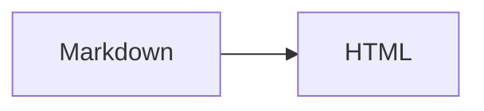
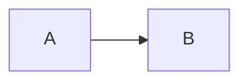

# Markdown

Markdown is a plain-text format for writing structured documents. You type readable markup - `#` for headings, `*` for
lists, `` ` `` for code - and a parser turns it into HTML. Edsger Dijkstra would hate the ambiguity; John Gruber
designed it so the source stays readable even before rendering.

This page is both a short tutorial and a cheat sheet. Examples show the source and what it becomes. Where this site diverges from "generic Markdown", that is called out explicitly.

## Why it won

| Property | Why it matters |
|----------|----------------|
| **Readable as source** | Diffs in Git stay human. No XML soup. |
| **Portable** | Same file works in GitHub, editors, static site generators, and many CMSs. |
| **Low ceremony** | Headings, lists, and links need almost no typing. |
| **Escapes to HTML** | When Markdown is not enough, you can drop in HTML (with caveats). |

The trade-off is under-specification. "Markdown" is a family of dialects, not one ISO standard. Write for the dialect your tool actually parses.

## Dialects you will meet

### CommonMark

[CommonMark](https://commonmark.org/) is a carefully specified, unambiguous baseline. Most modern parsers claim CommonMark compatibility. If something works in CommonMark, it usually works everywhere.

Useful mental model: **paragraphs, headings, emphasis, lists, links, images, code, blockquotes, thematic breaks, and
HTML blocks/spans**. No tables. No task lists. No strikethrough. No autolinks like `www.example.com` without angle
brackets in older interpretations - CommonMark does support `<https://example.com>` autolinks.

### GitHub Flavored Markdown (GFM)

[GFM](https://github.github.com/gfm/) extends CommonMark with the extras people expect on GitHub:

- Tables
- Task lists (`- [ ]` / `- [x]`)
- Strikethrough (`~~deleted~~`)
- Autolinked bare URLs
- Disallowed raw HTML in some contexts (security)

README files, issues, and pull requests are GFM. Many static site generators enable a GFM-compatible plugin set by default.

### MDX

[MDX](https://mdxjs.com/) is Markdown **plus JSX**. You can import React components and embed them in the document:

```mdx
import {Chart} from '@site/src/components/Chart';

# Revenue

<Chart series={data} />
```

MDX is stricter than Markdown about JSX-looking syntax. Characters like `{`, `}`, and `<` can become JSX delimiters. Prefer `.md` unless you need components. On this site, `markdown.format` is `'detect'`: `.md` stays Markdown; `.mdx` is MDX.

### What this site uses

| Layer     | Behaviour here                                                           |
|-----------|--------------------------------------------------------------------------|
| Files     | `.md` or `.mdx` under `docs/` (and `blog/`)                              |
| Detection | Extension decides Markdown vs MDX                                        |
| Extras    | GFM-style tables, task lists, strikethrough; footnotes enabled           |
| Diagrams  | Fenced `mermaid` blocks - see [Mermaid Diagrams](./mermaid-diagrams.mdx) |
| Callouts  | Docusaurus admonitions (`:::tip`, `:::warning`, ...)                     |
| Links     | `trailingSlash: true` - prefer relative file paths or trailing `/`       |
| Build     | `pnpm build` throws on broken Markdown links, images, and anchors        |

Practical rule: write **CommonMark + GFM extras** in `.md` files. Switch to `.mdx` only when you need React components or MDX-only features.

## Frontmatter

Docs pages start with YAML between `---` lines. Docusaurus reads it before the Markdown body:

```markdown
---
title: "Markdown"
description: "What Markdown is and how to write it on this site."
tags: [markdown, documentation]
---

# Markdown
```

Common fields on this site: `title`, `description`, `sidebar_label`, `tags`, `keywords`, occasionally `slug`. Sidebar
**order** for categories listed in `sidebar-order.ts` is controlled there - do not rely on `sidebar_position` alone for
those trees.

## Headings

Use ATX-style headings (`#` through `######`). Put a space after the hashes.

```markdown
# Heading 1
## Heading 2
### Heading 3
#### Heading 4
```

Rules of thumb:

- One H1 per page (the page title). On this site the H1 usually repeats the `title` frontmatter.
- Do not skip levels for styling (`##` then `####`). Screen readers and ToCs care about order.
- Keep headings short; put nuance in the paragraph under them.

Setext headings (`===` / `---` under a line) are valid CommonMark. Prefer ATX - they are harder to mistake for a
horizontal rule and easier to grep.

## Paragraphs and line breaks

Consecutive lines of text form one paragraph. A blank line starts a new one.

```markdown
First paragraph.

Second paragraph.
```

A single newline inside a paragraph is usually treated as a space (soft wrap), not a `<br>`. For a hard line break, end the line with two spaces, or use a `<br />` when you truly need it. Prefer separate paragraphs over forced breaks.

## Emphasis

```markdown
*italic* or _italic_
**bold** or __bold__
***bold italic***
~~strikethrough~~   <!-- GFM -->
```

Rendered:

*italic* or _italic_

**bold** or __bold__

***bold italic***

~~strikethrough~~

Prefer `*` / `**` over `_` / `__` inside words (`un*freaking*believable` works more reliably than underscores). Nest deliberately: `**bold with *italic* inside**`.

## Lists

### Unordered

```markdown
- Alpha
- Beta
    - Nested under Beta
    - Also nested
- Gamma
```

`-`, `*`, and `+` all work as bullet markers. Stick to one style per file (`-` is the house default).

### Ordered

```markdown
1. First
2. Second
3. Third
```

CommonMark renumbers automatically if you write `1.` on every line. Still write sensible numbers - the source should
read well.

### Loose vs tight

A blank line between items makes a *loose* list (items wrap in `<p>`). No blank line keeps a *tight* list. Mixing both in one list produces surprising HTML. Stay consistent.

### Task lists (GFM)

```markdown
- [x] Done
- [ ] Not done
- [ ] Also open
```

- [x] Done
- [ ] Not done
- [ ] Also open

Useful in checklists and RFCs. Not every Markdown preview outside GFM/Docusaurus will render the checkboxes.

## Links

### Inline

```markdown
[Docusaurus docs](https://docusaurus.io/docs)
[Local page](./docusaurus.md)
[Section on this page](#dialects-you-will-meet)
```

### Reference-style

```markdown
See the [performance guide][perf].

[perf]: ./web-performance.md "Web Performance"
```

Reference links help when the same URL appears often, or when a long URL would wreck line length.

### Autolinks

```markdown
<https://lucanerlich.com/>
<docs@example.com>
```

GFM also autolinks bare `https://...` URLs. Angle-bracket form is clearer and more portable.

### Link hygiene on this site

- Prefer **relative paths to other docs** (`./mermaid-diagrams.mdx`, `../javascript/...`) so renames and `pnpm build` link checks work.
- `trailingSlash: true` - published URLs end with `/`. Prefer file-relative links in source; if you write a site path,
  include the trailing slash.
- Broken Markdown links fail the production build. That is intentional.

## Images

```markdown


```

- Alt text is not optional decoration - it is the accessible name.
- Put site-wide assets under `static/` (referenced from the site root, e.g. `/images/...`).
- Prefer SVG or appropriately sized raster images; see [Images and Media](./web-content/images-and-media.md) for content guidance.

Reference-style images work the same way as reference links:

```markdown
![Logo][logo]

[logo]: /images/logo.svg "Site logo"
```

## Code

### Inline

Wrap short identifiers and commands in single backticks: `` `pnpm build` ``, `` `trailingSlash` ``.

If the code itself contains a backtick, add more backticks on the outside and pad with spaces:

````markdown
`` `raw backtick` ``
````

### Fenced blocks

Use three or more backticks (or tildes) and a language tag. Always set a language when you can - Prism highlighting on
this site expects it.

````markdown
```typescript
const trailingSlash = true;
```
````

```typescript
const trailingSlash = true;
```

To *document* a fenced block inside a fenced block, use a longer outer fence (four backticks wrapping a three-backtick example). That pattern is used throughout this page.

### Docusaurus code fence extras

Title and line highlighting (Infima / Docusaurus meta):

````markdown
```rust {2} title="main.rs"
fn main() {
    println!("This line is highlighted.");
}
```
````

More examples live in [Docusaurus](./docusaurus.md).

### Mermaid

Fenced blocks with the `mermaid` language render as diagrams. Syntax, diagram types, and pitfalls for **this** Mermaid
version are documented separately - use that guide instead of copying diagram recipes here:

````markdown

````

Full reference: [Mermaid Diagrams](./mermaid-diagrams.mdx).

## Blockquotes

```markdown
> Markdown is intended to be as easy-to-read and easy-to-write as possible.
>
> - John Gruber
```

> Markdown is intended to be as easy-to-read and easy-to-write as possible.
>
> - John Gruber

Nest with extra `>` markers. Lists and code fences work inside quotes. For editorial callouts on this site, prefer [admonitions](#admonitions) over nested blockquotes.

## Tables (GFM)

```markdown
| Dialect    | Tables | JSX |
|------------|:------:|-----|
| CommonMark | no     | no  |
| GFM        | yes    | no  |
| MDX        | yes*   | yes |
```

| Dialect    | Tables | JSX |
|------------|:------:|-----|
| CommonMark | no     | no  |
| GFM        | yes    | no  |
| MDX        | yes*   | yes |

Alignment uses `:` in the separator row (`:---`, `---:`, `:---:`). Keep tables narrow - wide tables are miserable on
mobile. Escape `|` in cells as `\|` when needed.

\* MDX documents still use Markdown tables in the Markdown parts of the file.

## Horizontal rules

Three or more hyphens, asterisks, or underscores on their own line:

```markdown
---
***
___
```

Leave blank lines around them. A line of `--` under text can be parsed as a Setext H2 - another reason to prefer ATX
headings and to keep rules clearly separated.

## Footnotes

This site enables footnotes (the footer label is localized to "Quellen / Fußnoten"). Syntax:

```markdown
Here is a statement with a footnote.[^1]

[^1]: Footnote content. Can include *Markdown*.
```

Footnote definitions can sit anywhere in the document; they are collected at render time. Use them for asides and sources, not for critical path content.

## HTML in Markdown

CommonMark allows raw HTML. That is powerful and easy to abuse.

```markdown
<kbd>Ctrl</kbd> + <kbd>C</kbd>

<div class="alert alert-primary" role="alert">
    Infima alert via raw HTML.
</div>
```

Guidelines:

- Prefer Markdown constructs when they exist.
- Raw HTML is useful for `<kbd>`, `<abbr title="...">`, video embeds you control, and Infima snippets (see [Docusaurus](./docusaurus.md)).
- In **MDX**, HTML-like tags are parsed as JSX. Self-close void elements (`<br />`, ``), and quote attributes properly.
- Do not paste untrusted HTML. Docs are trusted author content; still treat copy-paste from the internet carefully.

## Escaping

Backslash escapes ASCII punctuation so it is not interpreted as markup:

```markdown
\*not italic\*
\# not a heading
\[not a link\](x)
```

\*not italic\*

Inside inline code and fenced blocks, Markdown emphasis does not apply - use code spans when you are talking about
syntax characters.

In MDX, escape or wrap expressions that look like JSX (`\{`, `` `{'<'}` ``, or put ambiguous text in code spans).

## Admonitions

Docusaurus adds fenced admonition blocks (not standard Markdown):

```markdown
:::tip
Short tip body.
:::

:::warning[Title override]
Something easy to get wrong.
:::

:::danger
Destructive action ahead.
:::
```

:::tip
Short tip body.
:::

:::warning[Title override]
Something easy to get wrong.
:::

Common types: `note`, `tip`, `info`, `warning`, `danger`. Keep bodies short. If the callout is longer than a short paragraph plus an optional list, it probably wants its own section instead.

## MDX components

In `.mdx` files you can import and render React components:

```mdx
import BrowserWindow from '@site/src/components/BrowserWindow';

<BrowserWindow url="https://example.com">
    Content inside the fake browser chrome.
</BrowserWindow>
```

When to use MDX:

- Custom interactive widgets
- Reusable React demos
- Embedding site components that do not map to Markdown

When **not** to use MDX:

- Pure prose and syntax examples (this page is `.md` on purpose)
- Content that should stay portable to non-React renderers

MDX parsing will fail the build on JSX syntax errors. If a page suddenly breaks after adding a `<` character, check whether you are in an MDX file.

## Same idea, three dialects

A minimal cheat sheet for choosing syntax:

| Need | CommonMark | GFM / this site `.md` | MDX |
|------|------------|------------------------|-----|
| Heading / list / link | yes | yes | yes |
| Table / task list / `~~strike~~` | no | yes | yes (Markdown parts) |
| Footnote | via plugin | yes here | yes here |
| Mermaid fence | if tool supports | yes here | yes here |
| Admonition `:::tip` | no | Docusaurus | Docusaurus |
| `<Chart />` component | no | no | yes |
| Strict `{` / `<` handling | HTML rules | HTML rules | JSX rules |

## Authoring workflow for this repo

1. Create `docs/building-for-the-web/your-page.md` (or another category) with frontmatter.
2. Add the filename (no extension) to the right array in `sidebar-order.ts` when the category is ordered there.
3. Link with relative paths; use `--` for em dashes in prose (house style - not a Unicode em dash).
4. Run `pnpm build`. Fix any broken links, anchors, or images it reports.
5. Use `pnpm start --host 0.0.0.0 --port 3000` for a visual pass.

Indentation in examples and config snippets is **4 spaces**, matching `.editorconfig`.

## Quick reference

```markdown
# H1
## H2
### H3
Paragraphs separated by a blank line.
*italic*  **bold**  ~~strike~~  `code`
- unordered
1. ordered
- [ ] task
[text](./page.md)   
> blockquote
| a | b |
|---|---|
| 1 | 2 |
---
[^1] footnote

[^1]: definition
:::tip
Admonition
:::
```

````markdown
```language
fenced code
```


````

## Related pages

- [Docusaurus](./docusaurus.md) - site generator notes, Infima, code fence titles
- [Mermaid Diagrams](./mermaid-diagrams.mdx) - diagram types and syntax for this theme
- [Semantic HTML](./semantic-html.mdx) - what the rendered tags mean
- [Build a Blog](./build-a-blog.md) - content workflow practice
- [Structure and Hierarchy](./web-content/structure-and-hierarchy.md) - heading and outline craft beyond syntax
