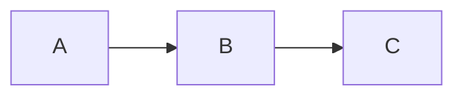
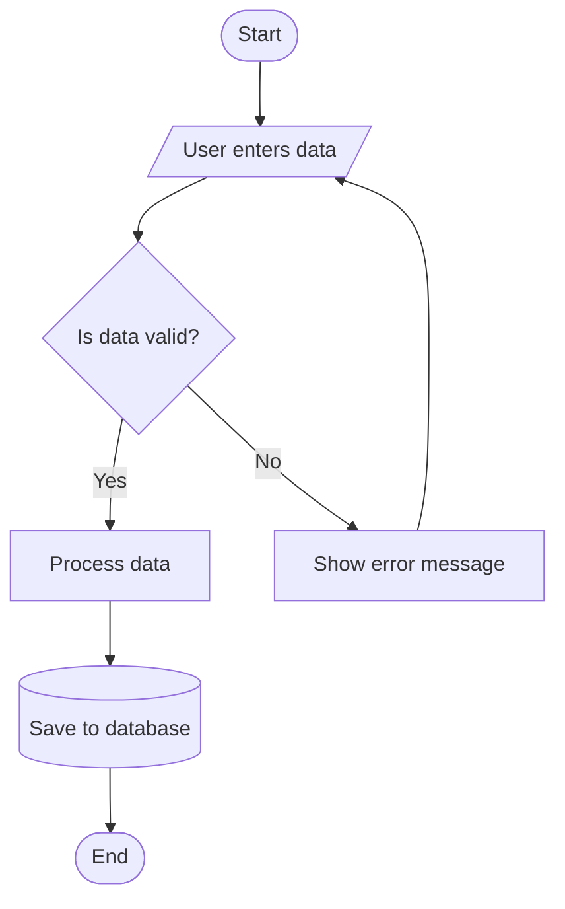
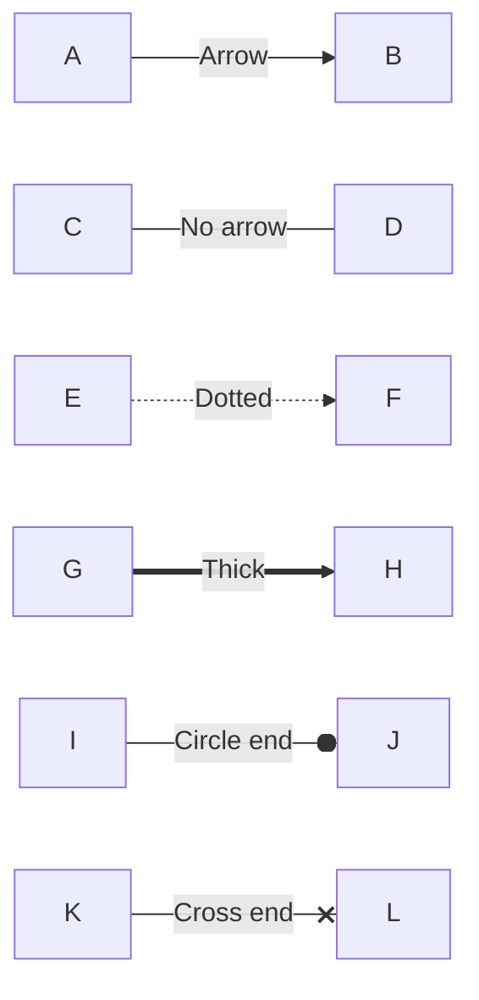
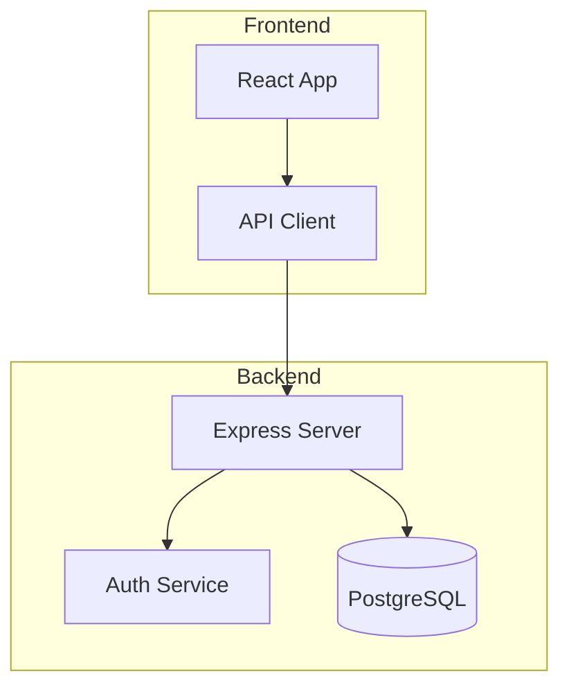
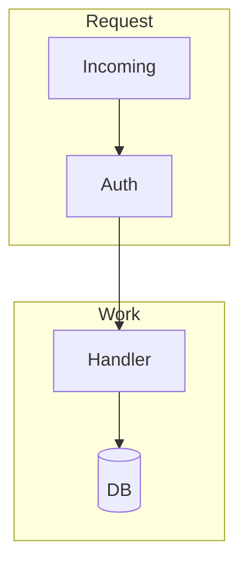
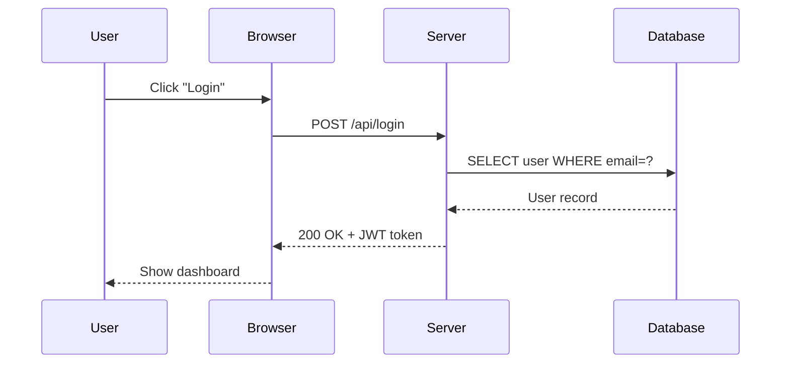
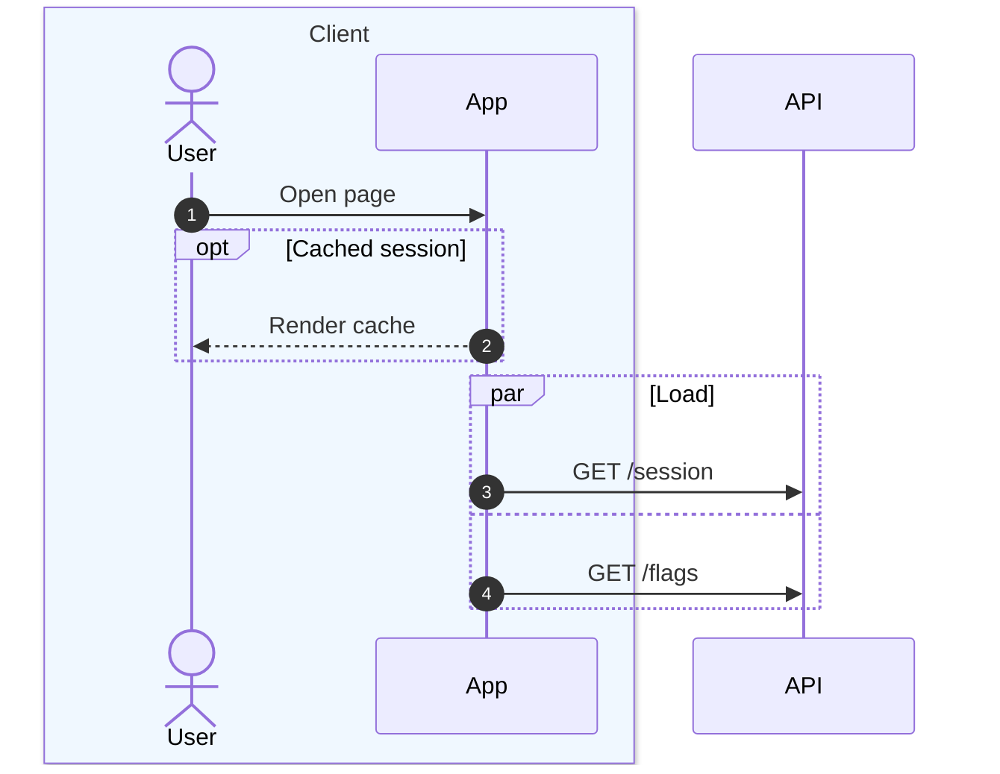
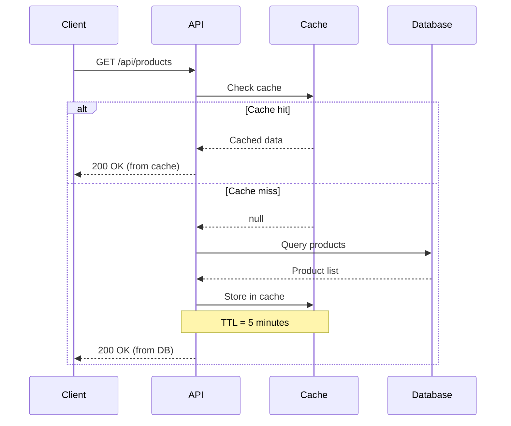

# Mermaid Diagrams Guide

[Mermaid](https://mermaid.js.org/) renders a diagram from a plain-text definition inside a Markdown code
block. You describe the picture next to the prose. There is no exported image to keep in sync.

The examples below are the working set for **this site**. They use syntax that Mermaid 12 accepts in the
Docusaurus theme configured here. Copy the `markdown` block under each diagram. The
[live editor](https://mermaid.live/) is useful for drafting, and it can be a different Mermaid release
than the one that publishes this page. Theme, dark mode, and what `pnpm build` does not check are in
[Mermaid in Docusaurus](#mermaid-in-docusaurus).

## Getting Started

In Docusaurus, you create a Mermaid diagram with a fenced code block using the `mermaid` language
identifier:

````markdown

````

This renders as:


A line that starts with `%%` is a comment. Mermaid drops it before parsing.

:::tip
Mermaid diagrams are **text-based and version-controlled**. They live alongside your documentation in Git,
making them easy to review, diff, and update. No external image files needed.
:::

## Diagram type selection guide

| You want to show... | Use |
|---------------------|-----|
| A process or decision flow | [Flowchart](#flowcharts) |
| Interactions between systems over time | [Sequence diagram](#sequence-diagrams) |
| Code structure and relationships | [Class diagram](#class-diagrams) |
| Object lifecycle and transitions | [State diagram](#state-diagrams) |
| Database schema | [ER diagram](#entity-relationship-diagrams) |
| Systems, groups, and how they connect | [Architecture diagram](#architecture-diagrams) |
| Project schedule | [Gantt chart](#gantt-charts) |
| Proportional data | [Pie chart](#pie-charts) |
| Values across categories | [XY chart](#xy-charts) |
| Git branching strategy | [Git graph](#gitgraph-diagrams) |
| Brainstorming / concepts | [Mind map](#mind-maps) |
| Project milestones | [Timeline](#timeline-diagrams) |
| Priority matrix | [Quadrant chart](#quadrant-charts) |
| User experience mapping | [User journey](#user-journey-diagrams) |

---

## Flowcharts

Flowcharts are the most common diagram type. They show processes, decisions, and directional flows.

### Direction

The first keyword sets the layout direction. `flowchart` is the current keyword. `graph` is the older
alias and still renders -- both go through the same parser. Prefer `flowchart` in new diagrams. If you
omit the direction, Mermaid lays the chart out top to bottom.

| Keyword | Direction |
|---------|-----------|
| `flowchart TD` or `flowchart TB` | Top to bottom |
| `flowchart BT` | Bottom to top |
| `flowchart LR` | Left to right |
| `flowchart RL` | Right to left |

### Basic flowchart


Source:

````markdown

````

### Node shapes

| Syntax | Shape | Use for |
|--------|-------|---------|
| `A[Text]` | Rectangle | Process / action |
| `A(Text)` | Rounded rectangle | General step |
| `A([Text])` | Stadium / pill | Start / end |
| `A{Text}` | Diamond | Decision |
| `A[/Text/]` | Parallelogram | Input / output |
| `A[\Text\]` | Reverse parallelogram | Manual input |
| `A[(Text)]` | Cylinder | Database / storage |
| `A[[Text]]` | Subroutine | Predefined process |
| `A((Text))` | Circle | Connector / event |
| `A>Text]` | Asymmetric | Flag / signal |
| `A{{Text}}` | Hexagon | Preparation |

### All node shapes in one diagram


Source:

````markdown

````

### Link types



Source:

````markdown

````

| Syntax | Style |
|--------|-------|
| `-->` | Arrow |
| `---` | Line (no arrow) |
| `-.->` | Dotted arrow |
| `==>` | Thick arrow |
| `--o` | Circle end |
| `--x` | Cross end |
| `-- text -->` or `-->|text|` | Label on link |

### Subgraphs

Group related nodes into named sections:



Source:

````markdown

````

### Direction inside a subgraph

A subgraph can set its own direction. Put `direction` on the first line inside the group. The outer
chart keeps the direction from the first line of the diagram.



Source:

````markdown

````

### Practical example: CI/CD pipeline


Source:

````markdown

````

---

## Sequence Diagrams

Sequence diagrams show interactions between participants (systems, services, users) over time.

### Basic sequence



Source:

````markdown

````

### Arrow types

| Syntax | Style |
|--------|-------|
| `->>` | Solid message arrow |
| `-->>` | Dashed message arrow, commonly used for replies |
| `-x` | Solid with cross (lost message) |
| `--x` | Dashed with cross |
| `-)` | Solid with open arrow (async) |
| `--)` | Dashed with open arrow |

### Numbers, options, and parallel work

`autonumber` prefixes each message with a step number. `opt` is an optional block. `alt` / `else`,
used in the cache example below, is the branch. `par` / `and` draw messages side by side. `actor`
draws a person and `participant` draws a box. `box` only groups them on the diagram -- message order
is still top to bottom.



Source:

````markdown

````

### Notes, loops, and alternatives



Source:

````markdown

````

### Activation (lifelines)

Show when a participant is actively processing:

```mermaid
sequenceDiagram
    participant Client
    participant Server
    participant Worker

    Client->>+Server: Submit job
    Server->>+Worker: Process async
    Server-->>-Client: 202 Accepted

    Note right of Worker: Processing...

    Worker-->>-Server: Job complete
    Server-)Client: Webhook notification
```

Source:

````markdown
```mermaid
sequenceDiagram
    participant Client
    participant Server
    participant Worker

    Client->>+Server: Submit job
    Server->>+Worker: Process async
    Server-->>-Client: 202 Accepted

    Note right of Worker: Processing...

    Worker-->>-Server: Job complete
    Server-)Client: Webhook notification
```
````

### Loops

```mermaid
sequenceDiagram
    participant App
    participant API
    participant DB as Database

    App->>API: Request page 1

    loop Paginate until empty
        API->>DB: SELECT ... LIMIT 50 OFFSET n
        DB-->>API: Results
        API-->>App: Page of results
        App->>API: Request next page
    end
```

Source:

````markdown
```mermaid
sequenceDiagram
    participant App
    participant API
    participant DB as Database

    App->>API: Request page 1

    loop Paginate until empty
        API->>DB: SELECT ... LIMIT 50 OFFSET n
        DB-->>API: Results
        API-->>App: Page of results
        App->>API: Request next page
    end
```
````

### Practical example: OAuth 2.0 flow

```mermaid
sequenceDiagram
    participant User
    participant App
    participant AuthServer as Auth Server
    participant Resource as Resource Server

    User->>App: Click "Login with Google"
    App->>AuthServer: Redirect to /authorize
    AuthServer->>User: Show consent screen
    User->>AuthServer: Grant permission
    AuthServer->>App: Redirect with auth code
    App->>AuthServer: POST /token (code + secret)
    AuthServer-->>App: Access token + Refresh token
    App->>Resource: GET /api/data (Bearer token)
    Resource-->>App: Protected data
    App-->>User: Display data
```

Source:

````markdown
```mermaid
sequenceDiagram
    participant User
    participant App
    participant AuthServer as Auth Server
    participant Resource as Resource Server

    User->>App: Click "Login with Google"
    App->>AuthServer: Redirect to /authorize
    AuthServer->>User: Show consent screen
    User->>AuthServer: Grant permission
    AuthServer->>App: Redirect with auth code
    App->>AuthServer: POST /token (code + secret)
    AuthServer-->>App: Access token + Refresh token
    App->>Resource: GET /api/data (Bearer token)
    Resource-->>App: Protected data
    App-->>User: Display data
```
````

---

## Class Diagrams

Class diagrams show the structure of a system: classes, attributes, methods, and relationships.

### Basic class diagram

```mermaid
classDiagram
    class Animal {
        +String name
        +int age
        +makeSound() void
        +move() void
    }

    class Dog {
        +String breed
        +fetch() void
        +makeSound() void
    }

    class Cat {
        +boolean isIndoor
        +purr() void
        +makeSound() void
    }

    Animal <|-- Dog : extends
    Animal <|-- Cat : extends
```

Source:

````markdown
```mermaid
classDiagram
    class Animal {
        +String name
        +int age
        +makeSound() void
        +move() void
    }

    class Dog {
        +String breed
        +fetch() void
        +makeSound() void
    }

    class Cat {
        +boolean isIndoor
        +purr() void
        +makeSound() void
    }

    Animal <|-- Dog : extends
    Animal <|-- Cat : extends
```
````

### Visibility modifiers

| Prefix | Meaning |
|--------|---------|
| `+` | Public |
| `-` | Private |
| `#` | Protected |
| `~` | Package/internal |

### Relationship types

```mermaid
classDiagram
    classA --|> classB : Inheritance
    classC --* classD : Composition
    classE --o classF : Aggregation
    classG --> classH : Association
    classI ..> classJ : Dependency
    classK ..|> classL : Realization
```

Source:

````markdown
```mermaid
classDiagram
    classA --|> classB : Inheritance
    classC --* classD : Composition
    classE --o classF : Aggregation
    classG --> classH : Association
    classI ..> classJ : Dependency
    classK ..|> classL : Realization
```
````

| Syntax | Relationship |
|--------|-------------|
| `<\|--` or `--\|>` | Inheritance (extends) |
| `*--` or `--*` | Composition (owns, lifecycle-bound) |
| `o--` or `--o` | Aggregation (has, independent lifecycle) |
| `-->` | Association (uses) |
| `..>` | Dependency (depends on) |
| `<\|..` or `..\|>` | Realization (implements) |

The arrowhead sits on the parent or the interface, so `<|--` and `--|>` are the same relation written
in opposite directions. A single dash does not parse: `classA -|> classB`, `classC -* classD`, and
`classE -o classF` all fail. Use two dashes, as in the diagram above.

### Practical example: repository pattern

```mermaid
classDiagram
    class UserRepository {
        <<interface>>
        +findById(id: String) User
        +findAll() List~User~
        +save(user: User) User
        +delete(id: String) void
    }

    class JpaUserRepository {
        -EntityManager em
        +findById(id: String) User
        +findAll() List~User~
        +save(user: User) User
        +delete(id: String) void
    }

    class UserService {
        -UserRepository repo
        +getUser(id: String) UserDTO
        +createUser(dto: CreateUserDTO) UserDTO
    }

    class User {
        +String id
        +String email
        +String name
        +LocalDateTime createdAt
    }

    UserRepository <|.. JpaUserRepository
    UserService --> UserRepository
    JpaUserRepository --> User
```

Source:

````markdown
```mermaid
classDiagram
    class UserRepository {
        <<interface>>
        +findById(id: String) User
        +findAll() List~User~
        +save(user: User) User
        +delete(id: String) void
    }

    class JpaUserRepository {
        -EntityManager em
        +findById(id: String) User
        +findAll() List~User~
        +save(user: User) User
        +delete(id: String) void
    }

    class UserService {
        -UserRepository repo
        +getUser(id: String) UserDTO
        +createUser(dto: CreateUserDTO) UserDTO
    }

    class User {
        +String id
        +String email
        +String name
        +LocalDateTime createdAt
    }

    UserRepository <|.. JpaUserRepository
    UserService --> UserRepository
    JpaUserRepository --> User
```
````

---

## State Diagrams

State diagrams show the possible states of a system and the transitions between them.

### Basic state diagram

```mermaid
stateDiagram-v2
    [*] --> Draft
    Draft --> InReview : Submit
    InReview --> Approved : Approve
    InReview --> Draft : Request changes
    Approved --> Published : Publish
    Published --> Archived : Archive
    Archived --> Draft : Restore
    Published --> Draft : Unpublish
    Archived --> [*]
```

Source:

````markdown
```mermaid
stateDiagram-v2
    [*] --> Draft
    Draft --> InReview : Submit
    InReview --> Approved : Approve
    InReview --> Draft : Request changes
    Approved --> Published : Publish
    Published --> Archived : Archive
    Archived --> Draft : Restore
    Published --> Draft : Unpublish
    Archived --> [*]
```
````

### Composite states

```mermaid
stateDiagram-v2
    [*] --> Idle

    state Processing {
        [*] --> Validating
        Validating --> Transforming : Valid
        Validating --> Failed : Invalid
        Transforming --> Saving
        Saving --> [*]
    }

    Idle --> Processing : Start job
    Processing --> Idle : Complete
    Processing --> Error : Exception
    Error --> Idle : Reset
```

Source:

````markdown
```mermaid
stateDiagram-v2
    [*] --> Idle

    state Processing {
        [*] --> Validating
        Validating --> Transforming : Valid
        Validating --> Failed : Invalid
        Transforming --> Saving
        Saving --> [*]
    }

    Idle --> Processing : Start job
    Processing --> Idle : Complete
    Processing --> Error : Exception
    Error --> Idle : Reset
```
````

### Practical example: order lifecycle

```mermaid
stateDiagram-v2
    [*] --> Placed

    Placed --> PaymentPending : Awaiting payment
    PaymentPending --> Paid : Payment received
    PaymentPending --> Cancelled : Timeout / Cancel

    Paid --> Picking : Send to warehouse
    Picking --> Packed : Items packed
    Packed --> Shipped : Carrier collected
    Shipped --> Delivered : Delivery confirmed

    Delivered --> [*]
    Cancelled --> [*]

    Shipped --> ReturnRequested : Customer returns
    ReturnRequested --> Returned : Return received
    Returned --> Refunded : Refund issued
    Refunded --> [*]
```

Source:

````markdown
```mermaid
stateDiagram-v2
    [*] --> Placed

    Placed --> PaymentPending : Awaiting payment
    PaymentPending --> Paid : Payment received
    PaymentPending --> Cancelled : Timeout / Cancel

    Paid --> Picking : Send to warehouse
    Picking --> Packed : Items packed
    Packed --> Shipped : Carrier collected
    Shipped --> Delivered : Delivery confirmed

    Delivered --> [*]
    Cancelled --> [*]

    Shipped --> ReturnRequested : Customer returns
    ReturnRequested --> Returned : Return received
    Returned --> Refunded : Refund issued
    Refunded --> [*]
```
````

---

## Entity Relationship Diagrams

ER diagrams model database schemas and the relationships between tables.

### Basic ER diagram

```mermaid
erDiagram
    USER ||--o{ ORDER : places
    ORDER ||--|{ ORDER_LINE : contains
    PRODUCT ||--o{ ORDER_LINE : "is in"
    USER {
        string id PK
        string email
        string name
        datetime created_at
    }
    ORDER {
        string id PK
        string user_id FK
        datetime order_date
        string status
        decimal total
    }
    ORDER_LINE {
        string id PK
        string order_id FK
        string product_id FK
        int quantity
        decimal unit_price
    }
    PRODUCT {
        string id PK
        string name
        string description
        decimal price
        int stock
    }
```

Source:

````markdown
```mermaid
erDiagram
    USER ||--o{ ORDER : places
    ORDER ||--|{ ORDER_LINE : contains
    PRODUCT ||--o{ ORDER_LINE : "is in"
    USER {
        string id PK
        string email
        string name
        datetime created_at
    }
    ORDER {
        string id PK
        string user_id FK
        datetime order_date
        string status
        decimal total
    }
    ORDER_LINE {
        string id PK
        string order_id FK
        string product_id FK
        int quantity
        decimal unit_price
    }
    PRODUCT {
        string id PK
        string name
        string description
        decimal price
        int stock
    }
```
````

### Relationship cardinality

| Syntax | Meaning |
|--------|---------|
| `\|\|--\|\|` | One to one |
| `\|\|--o{` | One to many |
| `o{--o{` | Many to many |
| `\|\|--o\|` | One to zero or one |

The symbols read as:

| Symbol | Meaning |
|--------|---------|
| `\|\|` | Exactly one |
| `o\|` | Zero or one |
| `\|{` | One or more |
| `o{` | Zero or more |

---

## Architecture Diagrams

An architecture diagram draws services inside groups and connects a side of one service to a side of
another. Built-in icons on this Mermaid build are `cloud`, `database`, `disk`, `internet`, `server`,
and `blank`. The first word of the block is `architecture-beta`.

Sides are `L`, `R`, `T`, and `B`. `reader:R -- L:pages` draws an edge from the right of `reader` to
the left of `pages`.

```mermaid
architecture-beta
    group site(cloud)[Docs site]

    service pages(server)[Docusaurus] in site
    service diagrams(disk)[Mermaid] in site

    service reader(internet)[Reader]

    reader:R -- L:pages
    pages:B -- T:diagrams
```

Source:

````markdown
```mermaid
architecture-beta
    group site(cloud)[Docs site]

    service pages(server)[Docusaurus] in site
    service diagrams(disk)[Mermaid] in site

    service reader(internet)[Reader]

    reader:R -- L:pages
    pages:B -- T:diagrams
```
````

---

## Gantt Charts

Gantt charts visualize project timelines, task durations, and dependencies.

```mermaid
gantt
    title Project Timeline
    dateFormat YYYY-MM-DD
    excludes weekends

    section Planning
        Requirements           :done,    req,  2025-01-06, 5d
        Architecture design    :done,    arch, after req,   3d
        Technical review       :done,    rev,  after arch,  2d

    section Development
        Backend API            :active,  api,  after rev,   10d
        Frontend UI            :active,  ui,   after rev,   12d
        Database schema        :         db,   after rev,   5d

    section Testing
        Integration tests      :         int,  after api,   5d
        UAT                    :         uat,  after ui,    5d

    section Deployment
        Staging deploy         :         stg,  after int,   2d
        Production deploy      :crit,    prod, after uat,   1d
```

Source:

````markdown
```mermaid
gantt
    title Project Timeline
    dateFormat YYYY-MM-DD
    excludes weekends

    section Planning
        Requirements           :done,    req,  2025-01-06, 5d
        Architecture design    :done,    arch, after req,   3d
        Technical review       :done,    rev,  after arch,  2d

    section Development
        Backend API            :active,  api,  after rev,   10d
        Frontend UI            :active,  ui,   after rev,   12d
        Database schema        :         db,   after rev,   5d

    section Testing
        Integration tests      :         int,  after api,   5d
        UAT                    :         uat,  after ui,    5d

    section Deployment
        Staging deploy         :         stg,  after int,   2d
        Production deploy      :crit,    prod, after uat,   1d
```
````

### Task status markers

| Marker | Meaning |
|--------|---------|
| `done` | Completed task (filled) |
| `active` | Currently in progress (highlighted) |
| `crit` | Critical path (red) |
| *(none)* | Future task |

### Date formats

```text
2025-01-15           Specific date
after taskId         After another task completes
5d                   Duration in days
2025-01-15, 10d      Start date + duration
2025-01-15, 2025-01-25  Start and end dates
```

---

## Pie Charts

Proportional data. `showData` prints the number next to the slice. Without it, the chart is shapes only.

```mermaid
pie showData title Website Traffic Sources
    "Organic Search" : 45
    "Direct" : 25
    "Social Media" : 15
    "Referral" : 10
    "Email" : 5
```

Source:

````markdown
```mermaid
pie showData title Website Traffic Sources
    "Organic Search" : 45
    "Direct" : 25
    "Social Media" : 15
    "Referral" : 10
    "Email" : 5
```
````

---

## XY Charts

A bar or line chart when the point is the values, not the share of a whole. The keyword is
`xychart-beta`. The axis range is `min --> max`.

```mermaid
xychart-beta
    title "Docs build minutes"
    x-axis [mon, tue, wed, thu, fri]
    y-axis "minutes" 0 --> 10
    bar [6, 5, 7, 4, 3]
    line [5, 5, 6, 4, 3]
```

Source:

````markdown
```mermaid
xychart-beta
    title "Docs build minutes"
    x-axis [mon, tue, wed, thu, fri]
    y-axis "minutes" 0 --> 10
    bar [6, 5, 7, 4, 3]
    line [5, 5, 6, 4, 3]
```
````

---

## Gitgraph Diagrams

Visualize Git branching strategies and merge flows. The first commits sit on `main`. That is Mermaid's
default branch name here (`gitGraph.mainBranchName`). `checkout main` at the end of the example
returns to it.

```mermaid
gitGraph
    commit id: "initial"
    commit id: "add-readme"

    branch develop
    checkout develop
    commit id: "dev-setup"
    commit id: "add-ci"

    branch feature/auth
    checkout feature/auth
    commit id: "auth-model"
    commit id: "auth-api"
    commit id: "auth-tests"

    checkout develop
    merge feature/auth id: "merge-auth"

    branch feature/dashboard
    checkout feature/dashboard
    commit id: "dashboard-ui"
    commit id: "dashboard-api"

    checkout develop
    merge feature/dashboard id: "merge-dashboard"

    checkout main
    merge develop id: "release-v1.0" tag: "v1.0.0"
```

Source:

````markdown
```mermaid
gitGraph
    commit id: "initial"
    commit id: "add-readme"

    branch develop
    checkout develop
    commit id: "dev-setup"
    commit id: "add-ci"

    branch feature/auth
    checkout feature/auth
    commit id: "auth-model"
    commit id: "auth-api"
    commit id: "auth-tests"

    checkout develop
    merge feature/auth id: "merge-auth"

    branch feature/dashboard
    checkout feature/dashboard
    commit id: "dashboard-ui"
    commit id: "dashboard-api"

    checkout develop
    merge feature/dashboard id: "merge-dashboard"

    checkout main
    merge develop id: "release-v1.0" tag: "v1.0.0"
```
````

---

## Mind Maps

Hierarchical brainstorming and concept mapping. Indentation is the tree. Use spaces, and keep the
nesting you see below.

```mermaid
mindmap
    root((Web Application))
        Frontend
            React
            TypeScript
            CSS Modules
            Testing
                Jest
                Cypress
        Backend
            Node.js
            Express
            Authentication
                JWT
                OAuth
            Database
                PostgreSQL
                Redis Cache
        Infrastructure
            Docker
            CI/CD
                GitHub Actions
            Monitoring
                Grafana
                Prometheus
        Documentation
            API Docs
            User Guide
            Architecture
```

Source:

````markdown
```mermaid
mindmap
    root((Web Application))
        Frontend
            React
            TypeScript
            CSS Modules
            Testing
                Jest
                Cypress
        Backend
            Node.js
            Express
            Authentication
                JWT
                OAuth
            Database
                PostgreSQL
                Redis Cache
        Infrastructure
            Docker
            CI/CD
                GitHub Actions
            Monitoring
                Grafana
                Prometheus
        Documentation
            API Docs
            User Guide
            Architecture
```
````

---

## Timeline Diagrams

Show events or milestones along a timeline. Each event is indented under its period. A second event
in the same period is another indented line that starts with `:`.

```mermaid
timeline
    title Product Roadmap 2025
    section Q1
        January : Requirements gathering
                : Team onboarding
        February : Architecture design
                 : Prototype
        March : MVP development
              : Internal testing
    section Q2
        April : Beta release
              : User feedback
        May : Iteration
            : Performance tuning
        June : Public launch
             : Marketing campaign
    section Q3
        July : Feature expansion
        August : Mobile app
        September : Analytics dashboard
```

Source:

````markdown
```mermaid
timeline
    title Product Roadmap 2025
    section Q1
        January : Requirements gathering
                : Team onboarding
        February : Architecture design
                 : Prototype
        March : MVP development
              : Internal testing
    section Q2
        April : Beta release
              : User feedback
        May : Iteration
            : Performance tuning
        June : Public launch
             : Marketing campaign
    section Q3
        July : Feature expansion
        August : Mobile app
        September : Analytics dashboard
```
````

---

## Quadrant Charts

Position items on a 2D matrix. Mermaid numbers the quadrants from the top-right, then
counter-clockwise. With effort on x and impact on y, that is not the Eisenhower reading order:
quick wins land in quadrant 2.

| Key | Corner | On the axes below |
|-----|--------|-------------------|
| `quadrant-1` | Top right | High effort, high impact |
| `quadrant-2` | Top left | Low effort, high impact |
| `quadrant-3` | Bottom left | Low effort, low impact |
| `quadrant-4` | Bottom right | High effort, low impact |

```mermaid
quadrantChart
    title Feature Prioritization
    x-axis Low Effort --> High Effort
    y-axis Low Impact --> High Impact

    quadrant-1 Plan carefully
    quadrant-2 Quick wins
    quadrant-3 Fill-ins
    quadrant-4 Avoid

    Search feature: [0.8, 0.9]
    Dark mode: [0.2, 0.5]
    Export to PDF: [0.6, 0.7]
    Emoji picker: [0.3, 0.2]
    SSO login: [0.7, 0.8]
    Font options: [0.15, 0.15]
    Auto-save: [0.25, 0.85]
    API v2: [0.9, 0.6]
```

Source:

````markdown
```mermaid
quadrantChart
    title Feature Prioritization
    x-axis Low Effort --> High Effort
    y-axis Low Impact --> High Impact

    quadrant-1 Plan carefully
    quadrant-2 Quick wins
    quadrant-3 Fill-ins
    quadrant-4 Avoid

    Search feature: [0.8, 0.9]
    Dark mode: [0.2, 0.5]
    Export to PDF: [0.6, 0.7]
    Emoji picker: [0.3, 0.2]
    SSO login: [0.7, 0.8]
    Font options: [0.15, 0.15]
    Auto-save: [0.25, 0.85]
    API v2: [0.9, 0.6]
```
````

---

## User Journey Diagrams

Map out user experiences through a system, tracking satisfaction at each step.

```mermaid
journey
    title User Onboarding Experience
    section Discovery
        Visit landing page: 5: User
        Read features: 4: User
        Watch demo video: 5: User
    section Sign Up
        Click sign up: 5: User
        Fill in form: 3: User
        Email verification: 2: User
        Complete profile: 3: User
    section First Use
        See dashboard: 4: User
        Create first project: 4: User
        Invite team member: 3: User
        Complete tutorial: 5: User
```

Source:

````markdown
```mermaid
journey
    title User Onboarding Experience
    section Discovery
        Visit landing page: 5: User
        Read features: 4: User
        Watch demo video: 5: User
    section Sign Up
        Click sign up: 5: User
        Fill in form: 3: User
        Email verification: 2: User
        Complete profile: 3: User
    section First Use
        See dashboard: 4: User
        Create first project: 4: User
        Invite team member: 3: User
        Complete tutorial: 5: User
```
````

The number (1-5) represents satisfaction: 1 = frustrated, 5 = delighted. This helps identify
pain points in the user experience.

---

## Tips and Best Practices

### Keep diagrams focused

A diagram that tries to show everything shows nothing. Each diagram should communicate **one idea**.
If your flowchart has more than 15-20 nodes, consider splitting it into multiple diagrams.

### Use meaningful node IDs

```text
# Hard to read
A --> B --> C --> D

# Self-documenting
Request --> Validate --> Process --> Respond
```

### Use aliases for long participant names

```mermaid
sequenceDiagram
    participant FE as Frontend App
    participant GW as API Gateway
    participant Auth as Auth Service
    participant DB as PostgreSQL

    FE->>GW: Request
    GW->>Auth: Validate token
    Auth-->>GW: Valid
    GW->>DB: Query
    DB-->>GW: Results
    GW-->>FE: Response
```

Source:

````markdown
```mermaid
sequenceDiagram
    participant FE as Frontend App
    participant GW as API Gateway
    participant Auth as Auth Service
    participant DB as PostgreSQL

    FE->>GW: Request
    GW->>Auth: Validate token
    Auth-->>GW: Valid
    GW->>DB: Query
    DB-->>GW: Results
    GW-->>FE: Response
```
````

### Quote labels that contain shape characters

Parentheses, brackets, braces, and pipes are shape syntax. In an unquoted node label they end the
node, and the diagram fails to parse. Put that label in double quotes:

```text
A["Process (main)"]
B["Use {id}"]
C["a | b"]
D["arr[0]"]
```

An edge label follows the same rule. `A -->|O(n)| B` fails. This works:

```text
A -->|"O(n) complexity"| B
```

A colon, hash, ampersand, or slash inside a node label does not need quotes: `A[Step 1: Initialize]`.
A unicode arrow is not a Mermaid edge. `A —> B` and `A → B` are lexical errors. The edge is three
ASCII characters: `-->`.

### Avoid common mistakes

| Mistake | What happens | Fix |
|---------|--------------|-----|
| Spaces in a node ID | Parse error | `userInput` or `user_input` |
| `end` as a node ID | `end` closes a subgraph, `alt`, `loop`, or `par` | `endNode` or `done` |
| One dash in a class relation | `-|>`, `-*`, and `-o` do not parse | `--|>`, `--*`, `--o` |
| Unquoted shape characters in a label | `()`, `[]`, `{}`, or a pipe ends the node | Double quotes around the label |
| `%%{init}%%` that sets `theme` | That diagram ignores the light/dark toggle | Leave the theme to the site config |
| `click node callback` | Ignored. `securityLevel` is `strict` and a diagram cannot lower it | Link from the prose instead |
| Omitting `TB` or `LR` | The flowchart defaults to top to bottom | Set the direction when it matters |
| Very long labels | The diagram becomes unreadable | Short labels, detail in the prose |
| Too many nodes | Visual clutter | Split into more than one diagram |

### Check the renderer that publishes the page

The live editor is a draft tool. Mermaid versions, enabled diagram types, and security settings differ
between this site, GitHub, GitLab, and editor extensions. Keep each diagram and the `markdown` source
under it identical.

```bash
pnpm build
```

`pnpm build` compiles the page. It does not parse Mermaid, and it does not parse the `markdown`
source fences that show the copy-paste text. A bad diagram still builds. Open the page: the theme
renders in the browser, and a syntax error shows up in the diagram's error boundary. Check light and
dark.

### Make diagrams accessible

Do not make a diagram the sole way to convey important information. Introduce it with a useful heading,
explain the conclusion in nearby prose, and give dense diagrams a caption or a short text alternative.
Use meaningful labels instead of anonymous node IDs, keep color from being the only signal, and check both
light and dark themes. Mermaid supports accessibility directives for diagram types that implement them:

```mermaid
flowchart LR
    accTitle: Sign-in request flow
    accDescr: The browser submits credentials to the application, which validates them and returns a session.
    Browser --> Application --> Session
```

````markdown
```mermaid
flowchart LR
    accTitle: Sign-in request flow
    accDescr: The browser submits credentials to the application, which validates them and returns a session.
    Browser --> Application --> Session
```
````

For diagrams with operational or security meaning, add a textual sequence or table as well. This also makes
the content searchable and understandable when SVG rendering is unavailable.

### Treat diagram input as untrusted

Do not interpolate user-controlled text into a Mermaid definition. This site keeps `securityLevel` at
`strict`, which sanitizes HTML in labels and ignores `click` callbacks. Do not loosen that in
`themeConfig.mermaid.options` without a reviewed reason. If application data must become a diagram,
validate and escape it first, and render it in the same environment in which users will view it.

---

## Mermaid in Docusaurus

Three settings in `docusaurus.config.ts` turn diagrams on:

```typescript
const config = {
    markdown: {
        mermaid: true,
    },
    themes: ['@docusaurus/theme-mermaid'],
    themeConfig: {
        mermaid: {
            theme: {light: 'default', dark: 'dark'},
        },
    },
};
```

`markdown.mermaid` tells the MDX loader to turn a code fence whose language is `mermaid` into a
diagram. The language has to be exactly that word. A title or a highlight range on the fence is
ignored: the block still renders, and the title does not appear.

`@docusaurus/theme-mermaid` 3.10 draws each diagram in the browser. It depends on `mermaid`
`>= 11.6.0`. This repo currently resolves Mermaid 12.0.0. The lockfile is the source of truth for
the version -- the live editor and a GitHub preview can be a different release.

The theme calls `mermaid.initialize` with `startOnLoad: false` and the theme for the active color
mode. Light mode uses Mermaid's `default` theme. Dark mode uses `dark`. The site default is dark,
and the color mode follows the system preference, so a diagram is drawn for the mode the reader
ends up with. Toggling color mode draws it again. `themeConfig.mermaid.options` is empty, so the
rest of Mermaid's defaults apply:

| Default | Value here | What it means |
|---------|------------|---------------|
| `securityLevel` | `strict` | HTML in labels is sanitized. `click` callbacks are ignored. A diagram cannot lower this with an `init` directive. |
| `htmlLabels` | `true` | A label may contain `<br/>` for a line break. Other HTML is stripped. |
| `look` | `classic` | The classic node style. This site does not set `look`. |
| `layout` | `elk` | Flowcharts use the ELK layout bundled with Mermaid 12. You do not need `@mermaid-js/layout-elk`. |
| `gitGraph.mainBranchName` | `main` | The first commits in a git graph sit on `main`. |

`securityLevel`, `startOnLoad`, `maxTextSize`, `suppressErrorRendering`, and `maxEdges` are locked.
An `%%{init}%%` block can still set `theme`, `look`, or `layout` for that one diagram. An init theme
stays put after the reader switches to dark mode. Leave it out unless you have checked both color
modes.

`classDef` fill and stroke colors are literal CSS. They do not follow the toggle. Prefer the theme
colors, and put the meaning in the label when color would otherwise be the only signal.

Diagrams are wrapped in `.docusaurus-mermaid-container`. `useMaxWidth` defaults to true, so the SVG
scales down to the column. A wide chart becomes unreadably small. Split it instead of overriding
layout for the whole site.

### Where Mermaid works

| Platform | Support |
|----------|---------|
| Docusaurus (with theme) | This site's configured renderer |
| GitHub Markdown | Native Mermaid rendering; supported syntax can differ from this site |
| GitLab Markdown | Native rendering on supported GitLab versions; verify the instance configuration |
| Notion | No equivalent built-in Mermaid code-block renderer; use an integration or an exported image |
| VS Code | Via an extension, whose Mermaid version and settings determine support |
| Confluence | Via an installed app/plugin |

### Diagram types not given a full example

Mermaid 12 also registers `block` / `block-beta`, C4 (`C4Context`, `C4Container`, `C4Component`,
`C4Dynamic`, `C4Deployment`), `sankey` / `sankey-beta`, `requirement` / `requirementDiagram`,
`kanban`, `packet` / `packet-beta`, and beta diagrams such as `radar-beta`, `treemap`,
`ishikawa`, `venn-beta`, `wardley-beta`, and `usecase-beta`. The keyword has to be the first word
of the block. Syntax for the beta types moves between minor releases. Render one on this site
before you standardize on it. The
[syntax reference](https://mermaid.js.org/intro/syntax-reference.html) is the catalog; this page is
the set that already renders here.

### Responsive diagrams

Wide diagrams are hard to read on a phone. Several focused diagrams beat one dense canvas. Use short
labels, and look at the page at a narrow width before you publish it.

### Live editor

Draft in the [Mermaid Live Editor](https://mermaid.live/), then paste the definition here and read
the page in both color modes. Export to SVG or PNG only when the destination has no Mermaid renderer.

## External Resources

- [Mermaid documentation](https://mermaid.js.org/intro/)
- [Mermaid syntax reference](https://mermaid.js.org/intro/syntax-reference.html)
- [Mermaid Live Editor](https://mermaid.live/)
- [Docusaurus diagrams](https://docusaurus.io/docs/markdown-features/diagrams)
- [GitHub diagrams](https://docs.github.com/get-started/writing-on-github/working-with-advanced-formatting/creating-diagrams)
