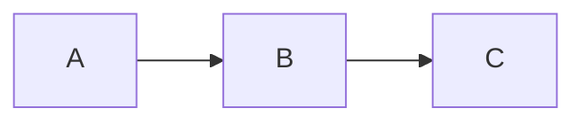
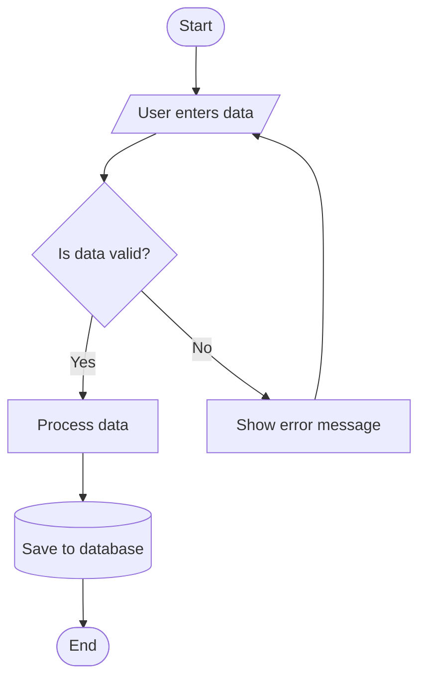
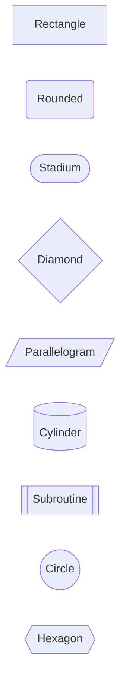
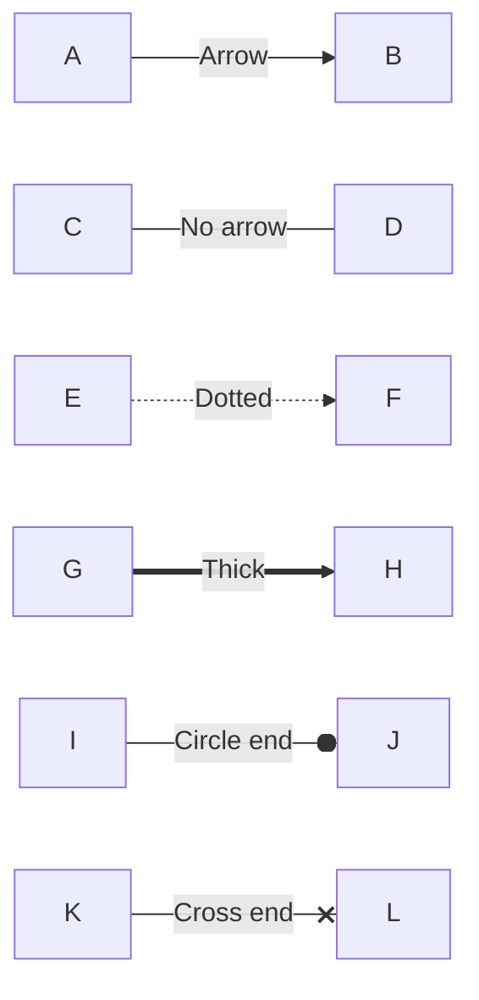
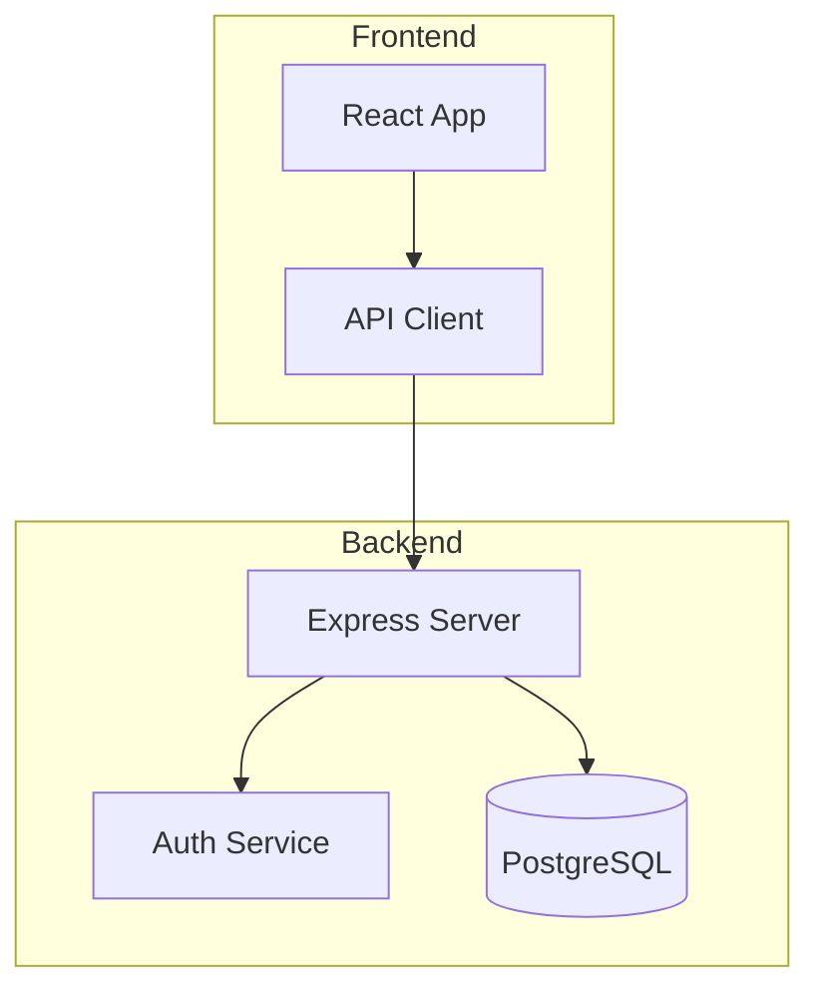
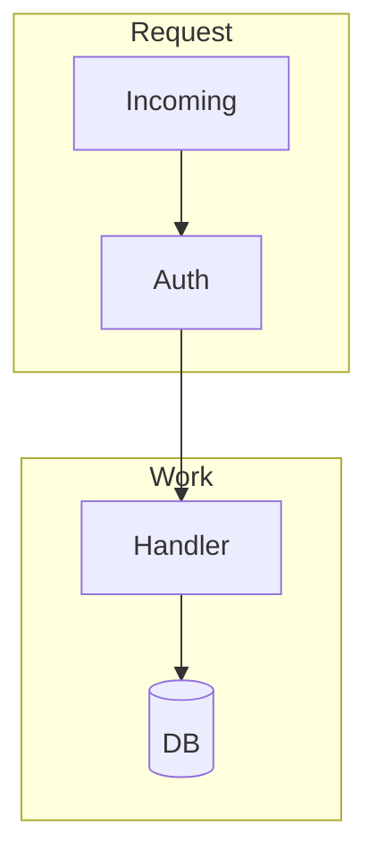
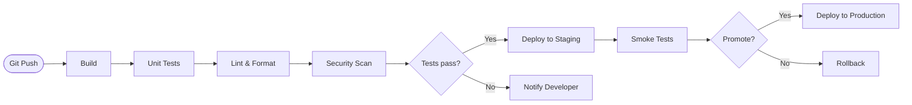
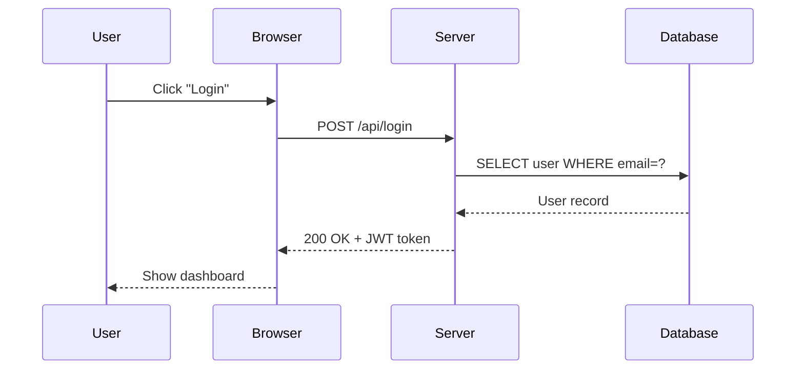
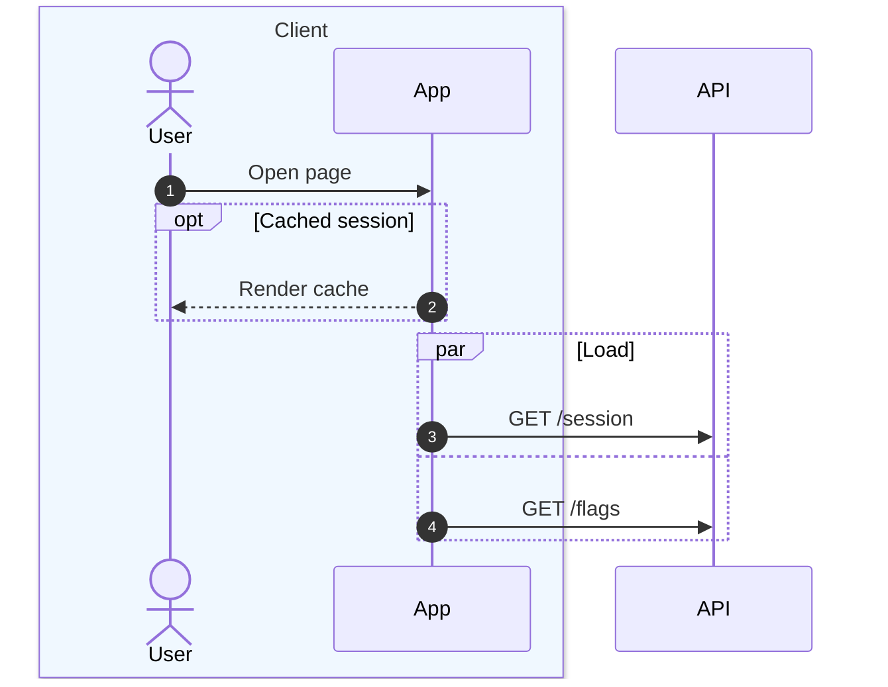
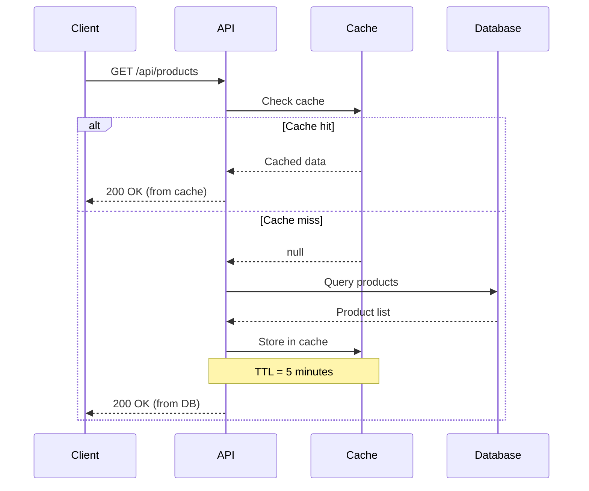

# Mermaid Diagrams Guide

[Mermaid](https://mermaid.js.org/) describes a diagram as plain text inside a Markdown code block.
You describe the picture next to the prose. There is no exported image to keep in sync.

The examples below are the working set for **this site**. They use the syntax that Pele, the renderer
here, accepts in the Mermaid 12.1 language. Copy the `markdown` block under each diagram. The
[live editor](https://mermaid.live/) is useful for drafting, but it draws with Mermaid, not Pele, so
spacing and layout differ. Rendering, theming, and the build checks are in
[How this site renders Mermaid](#how-this-site-renders-mermaid). To ship the same renderer in an
application, see [Using Pele in your app](#using-pele-in-your-app).

## Getting Started

In Docusaurus, you create a Mermaid diagram with a fenced code block using the `mermaid` language
identifier:

````markdown

````

This renders as:


A line that starts with `%%` is a comment. Mermaid drops it before parsing.

:::tip
Mermaid diagrams are **text-based and version-controlled**. They live alongside your documentation in Git,
making them easy to review, diff, and update. No external image files needed.
:::

## Diagram type selection guide

| You want to show... | Use |
|---------------------|-----|
| A process or decision flow | [Flowchart](#flowcharts) |
| Interactions between systems over time | [Sequence diagram](#sequence-diagrams) |
| Code structure and relationships | [Class diagram](#class-diagrams) |
| Object lifecycle and transitions | [State diagram](#state-diagrams) |
| Database schema | [ER diagram](#entity-relationship-diagrams) |
| Systems, groups, and how they connect | [Architecture diagram](#architecture-diagrams) |
| Project schedule | [Gantt chart](#gantt-charts) |
| Proportional data | [Pie chart](#pie-charts) |
| Values across categories | [XY chart](#xy-charts) |
| Git branching strategy | [Git graph](#gitgraph-diagrams) |
| Brainstorming / concepts | [Mind map](#mind-maps) |
| Project milestones | [Timeline](#timeline-diagrams) |
| Priority matrix | [Quadrant chart](#quadrant-charts) |
| User experience mapping | [User journey](#user-journey-diagrams) |
| Blocks in a grid | [Block diagram](#block-diagrams) |
| People and systems around a product | [C4 diagram](#c4-diagrams) |
| How much flows between stages | [Sankey diagram](#sankey-diagrams) |
| A requirement and what meets it | [Requirement diagram](#requirement-diagrams) |
| Work moving across columns | [Kanban](#kanban) |
| Fields packed into a fixed width | [Packet diagram](#packet-diagrams) |
| Scores on several axes | [Radar chart](#radar-charts) |
| Nested amounts | [Treemap](#treemaps) |
| Causes of one effect | [Ishikawa diagram](#ishikawa-diagrams) |
| Overlapping sets | [Venn diagram](#venn-diagrams) |
| How components evolve | [Wardley map](#wardley-maps) |
| Actors and what they do | [Use case diagram](#use-case-diagrams) |

---

## Flowcharts

Flowcharts are the most common diagram type. They show processes, decisions, and directional flows.

### Direction

The first keyword sets the layout direction. `flowchart` is the current keyword. `graph` is the older
alias and still renders - both go through the same parser. Prefer `flowchart` in new diagrams. If you
omit the direction, Mermaid lays the chart out top to bottom.

| Keyword | Direction |
|---------|-----------|
| `flowchart TD` or `flowchart TB` | Top to bottom |
| `flowchart BT` | Bottom to top |
| `flowchart LR` | Left to right |
| `flowchart RL` | Right to left |

### Basic flowchart


Source:

````markdown

````

### Node shapes

| Syntax | Shape | Use for |
|--------|-------|---------|
| `A[Text]` | Rectangle | Process / action |
| `A(Text)` | Rounded rectangle | General step |
| `A([Text])` | Stadium / pill | Start / end |
| `A{Text}` | Diamond | Decision |
| `A[/Text/]` | Parallelogram | Input / output |
| `A[\Text\]` | Reverse parallelogram | Manual input |
| `A[(Text)]` | Cylinder | Database / storage |
| `A[[Text]]` | Subroutine | Predefined process |
| `A((Text))` | Circle | Connector / event |
| `A>Text]` | Asymmetric | Flag / signal |
| `A{{Text}}` | Hexagon | Preparation |

### All node shapes in one diagram



Source:

````markdown

````

### Link types



Source:

````markdown

````

| Syntax | Style |
|--------|-------|
| `-->` | Arrow |
| `---` | Line (no arrow) |
| `-.->` | Dotted arrow |
| `==>` | Thick arrow |
| `--o` | Circle end |
| `--x` | Cross end |
| `-- text -->` or `-->|text|` | Label on link |

### Subgraphs

Group related nodes into named sections:



Source:

````markdown

````

### Direction inside a subgraph

A subgraph can set its own direction. Put `direction` on the first line inside the group. The outer
chart keeps the direction from the first line of the diagram.



Source:

````markdown

````

### Practical example: CI/CD pipeline



Source:

````markdown

````

---

## Sequence Diagrams

Sequence diagrams show interactions between participants (systems, services, users) over time.

### Basic sequence



Source:

````markdown

````

### Arrow types

| Syntax | Style |
|--------|-------|
| `->>` | Solid message arrow |
| `-->>` | Dashed message arrow, commonly used for replies |
| `-x` | Solid with cross (lost message) |
| `--x` | Dashed with cross |
| `-)` | Solid with open arrow (async) |
| `--)` | Dashed with open arrow |

### Numbers, options, and parallel work

`autonumber` prefixes each message with a step number. `opt` is an optional block. `alt` / `else`,
used in the cache example below, is the branch. `par` / `and` draw messages side by side. `actor`
draws a person and `participant` draws a box. `box` only groups them on the diagram - message order
is still top to bottom.



Source:

````markdown

````

### Notes, loops, and alternatives



Source:

````markdown

````

### Activation (lifelines)

Show when a participant is actively processing:

```mermaid
sequenceDiagram
    participant Client
    participant Server
    participant Worker

    Client->>+Server: Submit job
    Server->>+Worker: Process async
    Server-->>-Client: 202 Accepted

    Note right of Worker: Processing...

    Worker-->>-Server: Job complete
    Server-)Client: Webhook notification
```

Source:

````markdown
```mermaid
sequenceDiagram
    participant Client
    participant Server
    participant Worker

    Client->>+Server: Submit job
    Server->>+Worker: Process async
    Server-->>-Client: 202 Accepted

    Note right of Worker: Processing...

    Worker-->>-Server: Job complete
    Server-)Client: Webhook notification
```
````

### Loops

```mermaid
sequenceDiagram
    participant App
    participant API
    participant DB as Database

    App->>API: Request page 1

    loop Paginate until empty
        API->>DB: SELECT ... LIMIT 50 OFFSET n
        DB-->>API: Results
        API-->>App: Page of results
        App->>API: Request next page
    end
```

Source:

````markdown
```mermaid
sequenceDiagram
    participant App
    participant API
    participant DB as Database

    App->>API: Request page 1

    loop Paginate until empty
        API->>DB: SELECT ... LIMIT 50 OFFSET n
        DB-->>API: Results
        API-->>App: Page of results
        App->>API: Request next page
    end
```
````

### Practical example: OAuth 2.0 flow

```mermaid
sequenceDiagram
    participant User
    participant App
    participant AuthServer as Auth Server
    participant Resource as Resource Server

    User->>App: Click "Login with Google"
    App->>AuthServer: Redirect to /authorize
    AuthServer->>User: Show consent screen
    User->>AuthServer: Grant permission
    AuthServer->>App: Redirect with auth code
    App->>AuthServer: POST /token (code + secret)
    AuthServer-->>App: Access token + Refresh token
    App->>Resource: GET /api/data (Bearer token)
    Resource-->>App: Protected data
    App-->>User: Display data
```

Source:

````markdown
```mermaid
sequenceDiagram
    participant User
    participant App
    participant AuthServer as Auth Server
    participant Resource as Resource Server

    User->>App: Click "Login with Google"
    App->>AuthServer: Redirect to /authorize
    AuthServer->>User: Show consent screen
    User->>AuthServer: Grant permission
    AuthServer->>App: Redirect with auth code
    App->>AuthServer: POST /token (code + secret)
    AuthServer-->>App: Access token + Refresh token
    App->>Resource: GET /api/data (Bearer token)
    Resource-->>App: Protected data
    App-->>User: Display data
```
````

---

## Class Diagrams

Class diagrams show the structure of a system: classes, attributes, methods, and relationships.

### Basic class diagram

```mermaid
classDiagram
    class Animal {
        +String name
        +int age
        +makeSound() void
        +move() void
    }

    class Dog {
        +String breed
        +fetch() void
        +makeSound() void
    }

    class Cat {
        +boolean isIndoor
        +purr() void
        +makeSound() void
    }

    Animal <|-- Dog : extends
    Animal <|-- Cat : extends
```

Source:

````markdown
```mermaid
classDiagram
    class Animal {
        +String name
        +int age
        +makeSound() void
        +move() void
    }

    class Dog {
        +String breed
        +fetch() void
        +makeSound() void
    }

    class Cat {
        +boolean isIndoor
        +purr() void
        +makeSound() void
    }

    Animal <|-- Dog : extends
    Animal <|-- Cat : extends
```
````

### Visibility modifiers

| Prefix | Meaning |
|--------|---------|
| `+` | Public |
| `-` | Private |
| `#` | Protected |
| `~` | Package/internal |

### Relationship types

```mermaid
classDiagram
    classA --|> classB : Inheritance
    classC --* classD : Composition
    classE --o classF : Aggregation
    classG --> classH : Association
    classI ..> classJ : Dependency
    classK ..|> classL : Realization
```

Source:

````markdown
```mermaid
classDiagram
    classA --|> classB : Inheritance
    classC --* classD : Composition
    classE --o classF : Aggregation
    classG --> classH : Association
    classI ..> classJ : Dependency
    classK ..|> classL : Realization
```
````

| Syntax | Relationship |
|--------|-------------|
| `<\|--` or `--\|>` | Inheritance (extends) |
| `*--` or `--*` | Composition (owns, lifecycle-bound) |
| `o--` or `--o` | Aggregation (has, independent lifecycle) |
| `-->` | Association (uses) |
| `..>` | Dependency (depends on) |
| `<\|..` or `..\|>` | Realization (implements) |

The arrowhead sits on the parent or the interface, so `<|--` and `--|>` are the same relation written
in opposite directions. A single dash does not parse: `classA -|> classB`, `classC -* classD`, and
`classE -o classF` all fail. Use two dashes, as in the diagram above.

### Practical example: repository pattern

```mermaid
classDiagram
    class UserRepository {
        <<interface>>
        +findById(id: String) User
        +findAll() List~User~
        +save(user: User) User
        +delete(id: String) void
    }

    class JpaUserRepository {
        -EntityManager em
        +findById(id: String) User
        +findAll() List~User~
        +save(user: User) User
        +delete(id: String) void
    }

    class UserService {
        -UserRepository repo
        +getUser(id: String) UserDTO
        +createUser(dto: CreateUserDTO) UserDTO
    }

    class User {
        +String id
        +String email
        +String name
        +LocalDateTime createdAt
    }

    UserRepository <|.. JpaUserRepository
    UserService --> UserRepository
    JpaUserRepository --> User
```

Source:

````markdown
```mermaid
classDiagram
    class UserRepository {
        <<interface>>
        +findById(id: String) User
        +findAll() List~User~
        +save(user: User) User
        +delete(id: String) void
    }

    class JpaUserRepository {
        -EntityManager em
        +findById(id: String) User
        +findAll() List~User~
        +save(user: User) User
        +delete(id: String) void
    }

    class UserService {
        -UserRepository repo
        +getUser(id: String) UserDTO
        +createUser(dto: CreateUserDTO) UserDTO
    }

    class User {
        +String id
        +String email
        +String name
        +LocalDateTime createdAt
    }

    UserRepository <|.. JpaUserRepository
    UserService --> UserRepository
    JpaUserRepository --> User
```
````

---

## State Diagrams

State diagrams show the possible states of a system and the transitions between them.

### Basic state diagram

```mermaid
stateDiagram-v2
    [*] --> Draft
    Draft --> InReview : Submit
    InReview --> Approved : Approve
    InReview --> Draft : Request changes
    Approved --> Published : Publish
    Published --> Archived : Archive
    Archived --> Draft : Restore
    Published --> Draft : Unpublish
    Archived --> [*]
```

Source:

````markdown
```mermaid
stateDiagram-v2
    [*] --> Draft
    Draft --> InReview : Submit
    InReview --> Approved : Approve
    InReview --> Draft : Request changes
    Approved --> Published : Publish
    Published --> Archived : Archive
    Archived --> Draft : Restore
    Published --> Draft : Unpublish
    Archived --> [*]
```
````

### Composite states

```mermaid
stateDiagram-v2
    [*] --> Idle

    state Processing {
        [*] --> Validating
        Validating --> Transforming : Valid
        Validating --> Failed : Invalid
        Transforming --> Saving
        Saving --> [*]
    }

    Idle --> Processing : Start job
    Processing --> Idle : Complete
    Processing --> Error : Exception
    Error --> Idle : Reset
```

Source:

````markdown
```mermaid
stateDiagram-v2
    [*] --> Idle

    state Processing {
        [*] --> Validating
        Validating --> Transforming : Valid
        Validating --> Failed : Invalid
        Transforming --> Saving
        Saving --> [*]
    }

    Idle --> Processing : Start job
    Processing --> Idle : Complete
    Processing --> Error : Exception
    Error --> Idle : Reset
```
````

### Practical example: order lifecycle

```mermaid
stateDiagram-v2
    [*] --> Placed

    Placed --> PaymentPending : Awaiting payment
    PaymentPending --> Paid : Payment received
    PaymentPending --> Cancelled : Timeout / Cancel

    Paid --> Picking : Send to warehouse
    Picking --> Packed : Items packed
    Packed --> Shipped : Carrier collected
    Shipped --> Delivered : Delivery confirmed

    Delivered --> [*]
    Cancelled --> [*]

    Shipped --> ReturnRequested : Customer returns
    ReturnRequested --> Returned : Return received
    Returned --> Refunded : Refund issued
    Refunded --> [*]
```

Source:

````markdown
```mermaid
stateDiagram-v2
    [*] --> Placed

    Placed --> PaymentPending : Awaiting payment
    PaymentPending --> Paid : Payment received
    PaymentPending --> Cancelled : Timeout / Cancel

    Paid --> Picking : Send to warehouse
    Picking --> Packed : Items packed
    Packed --> Shipped : Carrier collected
    Shipped --> Delivered : Delivery confirmed

    Delivered --> [*]
    Cancelled --> [*]

    Shipped --> ReturnRequested : Customer returns
    ReturnRequested --> Returned : Return received
    Returned --> Refunded : Refund issued
    Refunded --> [*]
```
````

---

## Entity Relationship Diagrams

ER diagrams model database schemas and the relationships between tables.

### Basic ER diagram

```mermaid
erDiagram
    USER ||--o{ ORDER : places
    ORDER ||--|{ ORDER_LINE : contains
    PRODUCT ||--o{ ORDER_LINE : "is in"
    USER {
        string id PK
        string email
        string name
        datetime created_at
    }
    ORDER {
        string id PK
        string user_id FK
        datetime order_date
        string status
        decimal total
    }
    ORDER_LINE {
        string id PK
        string order_id FK
        string product_id FK
        int quantity
        decimal unit_price
    }
    PRODUCT {
        string id PK
        string name
        string description
        decimal price
        int stock
    }
```

Source:

````markdown
```mermaid
erDiagram
    USER ||--o{ ORDER : places
    ORDER ||--|{ ORDER_LINE : contains
    PRODUCT ||--o{ ORDER_LINE : "is in"
    USER {
        string id PK
        string email
        string name
        datetime created_at
    }
    ORDER {
        string id PK
        string user_id FK
        datetime order_date
        string status
        decimal total
    }
    ORDER_LINE {
        string id PK
        string order_id FK
        string product_id FK
        int quantity
        decimal unit_price
    }
    PRODUCT {
        string id PK
        string name
        string description
        decimal price
        int stock
    }
```
````

### Relationship cardinality

| Syntax | Meaning |
|--------|---------|
| `\|\|--\|\|` | One to one |
| `\|\|--o{` | One to many |
| `o{--o{` | Many to many |
| `\|\|--o\|` | One to zero or one |

The symbols read as:

| Symbol | Meaning |
|--------|---------|
| `\|\|` | Exactly one |
| `o\|` | Zero or one |
| `\|{` | One or more |
| `o{` | Zero or more |

---

## Architecture Diagrams

An architecture diagram draws services inside groups and connects a side of one service to a side of
another. Built-in icons on this Mermaid build are `cloud`, `database`, `disk`, `internet`, `server`,
and `blank`. The first word of the block is `architecture-beta`.

Sides are `L`, `R`, `T`, and `B`. `reader:R -- L:pages` draws an edge from the right of `reader` to
the left of `pages`.

```mermaid
architecture-beta
    group site(cloud)[Docs site]

    service pages(server)[Docusaurus] in site
    service diagrams(disk)[Mermaid] in site

    service reader(internet)[Reader]

    reader:R -- L:pages
    pages:B -- T:diagrams
```

Source:

````markdown
```mermaid
architecture-beta
    group site(cloud)[Docs site]

    service pages(server)[Docusaurus] in site
    service diagrams(disk)[Mermaid] in site

    service reader(internet)[Reader]

    reader:R -- L:pages
    pages:B -- T:diagrams
```
````

---

## Gantt Charts

Gantt charts visualize project timelines, task durations, and dependencies.

```mermaid
gantt
    title Project Timeline
    dateFormat YYYY-MM-DD
    excludes weekends

    section Planning
        Requirements           :done,    req,  2025-01-06, 5d
        Architecture design    :done,    arch, after req,   3d
        Technical review       :done,    rev,  after arch,  2d

    section Development
        Backend API            :active,  api,  after rev,   10d
        Frontend UI            :active,  ui,   after rev,   12d
        Database schema        :         db,   after rev,   5d

    section Testing
        Integration tests      :         int,  after api,   5d
        UAT                    :         uat,  after ui,    5d

    section Deployment
        Staging deploy         :         stg,  after int,   2d
        Production deploy      :crit,    prod, after uat,   1d
```

Source:

````markdown
```mermaid
gantt
    title Project Timeline
    dateFormat YYYY-MM-DD
    excludes weekends

    section Planning
        Requirements           :done,    req,  2025-01-06, 5d
        Architecture design    :done,    arch, after req,   3d
        Technical review       :done,    rev,  after arch,  2d

    section Development
        Backend API            :active,  api,  after rev,   10d
        Frontend UI            :active,  ui,   after rev,   12d
        Database schema        :         db,   after rev,   5d

    section Testing
        Integration tests      :         int,  after api,   5d
        UAT                    :         uat,  after ui,    5d

    section Deployment
        Staging deploy         :         stg,  after int,   2d
        Production deploy      :crit,    prod, after uat,   1d
```
````

### Task status markers

| Marker | Meaning |
|--------|---------|
| `done` | Completed task (filled) |
| `active` | Currently in progress (highlighted) |
| `crit` | Critical path (red) |
| *(none)* | Future task |

### Date formats

```text
2025-01-15           Specific date
after taskId         After another task completes
5d                   Duration in days
2025-01-15, 10d      Start date + duration
2025-01-15, 2025-01-25  Start and end dates
```

---

## Pie Charts

Proportional data. `showData` prints the number next to the slice. Without it, the chart is shapes only.

```mermaid
pie showData title Website Traffic Sources
    "Organic Search" : 45
    "Direct" : 25
    "Social Media" : 15
    "Referral" : 10
    "Email" : 5
```

Source:

````markdown
```mermaid
pie showData title Website Traffic Sources
    "Organic Search" : 45
    "Direct" : 25
    "Social Media" : 15
    "Referral" : 10
    "Email" : 5
```
````

---

## XY Charts

A bar or line chart when the point is the values, not the share of a whole. The keyword is
`xychart-beta`. The axis range is `min --> max`.

```mermaid
xychart-beta
    title "Docs build minutes"
    x-axis [mon, tue, wed, thu, fri]
    y-axis "minutes" 0 --> 10
    bar [6, 5, 7, 4, 3]
    line [5, 5, 6, 4, 3]
```

Source:

````markdown
```mermaid
xychart-beta
    title "Docs build minutes"
    x-axis [mon, tue, wed, thu, fri]
    y-axis "minutes" 0 --> 10
    bar [6, 5, 7, 4, 3]
    line [5, 5, 6, 4, 3]
```
````

---

## Gitgraph Diagrams

Visualize Git branching strategies and merge flows. The first commits sit on `main`, the default
branch name Pele uses for a git graph. `checkout main` at the end of the example returns to it.

```mermaid
gitGraph
    commit id: "initial"
    commit id: "add-readme"

    branch develop
    checkout develop
    commit id: "dev-setup"
    commit id: "add-ci"

    branch feature/auth
    checkout feature/auth
    commit id: "auth-model"
    commit id: "auth-api"
    commit id: "auth-tests"

    checkout develop
    merge feature/auth id: "merge-auth"

    branch feature/dashboard
    checkout feature/dashboard
    commit id: "dashboard-ui"
    commit id: "dashboard-api"

    checkout develop
    merge feature/dashboard id: "merge-dashboard"

    checkout main
    merge develop id: "release-v1.0" tag: "v1.0.0"
```

Source:

````markdown
```mermaid
gitGraph
    commit id: "initial"
    commit id: "add-readme"

    branch develop
    checkout develop
    commit id: "dev-setup"
    commit id: "add-ci"

    branch feature/auth
    checkout feature/auth
    commit id: "auth-model"
    commit id: "auth-api"
    commit id: "auth-tests"

    checkout develop
    merge feature/auth id: "merge-auth"

    branch feature/dashboard
    checkout feature/dashboard
    commit id: "dashboard-ui"
    commit id: "dashboard-api"

    checkout develop
    merge feature/dashboard id: "merge-dashboard"

    checkout main
    merge develop id: "release-v1.0" tag: "v1.0.0"
```
````

---

## Mind Maps

Hierarchical brainstorming and concept mapping. Indentation is the tree. Use spaces, and keep the
nesting you see below.

```mermaid
mindmap
    root((Web Application))
        Frontend
            React
            TypeScript
            CSS Modules
            Testing
                Jest
                Cypress
        Backend
            Node.js
            Express
            Authentication
                JWT
                OAuth
            Database
                PostgreSQL
                Redis Cache
        Infrastructure
            Docker
            CI/CD
                GitHub Actions
            Monitoring
                Grafana
                Prometheus
        Documentation
            API Docs
            User Guide
            Architecture
```

Source:

````markdown
```mermaid
mindmap
    root((Web Application))
        Frontend
            React
            TypeScript
            CSS Modules
            Testing
                Jest
                Cypress
        Backend
            Node.js
            Express
            Authentication
                JWT
                OAuth
            Database
                PostgreSQL
                Redis Cache
        Infrastructure
            Docker
            CI/CD
                GitHub Actions
            Monitoring
                Grafana
                Prometheus
        Documentation
            API Docs
            User Guide
            Architecture
```
````

---

## Timeline Diagrams

Show events or milestones along a timeline. Each event is indented under its period. A second event
in the same period is another indented line that starts with `:`.

```mermaid
timeline
    title Product Roadmap 2025
    section Q1
        January : Requirements gathering
                : Team onboarding
        February : Architecture design
                 : Prototype
        March : MVP development
              : Internal testing
    section Q2
        April : Beta release
              : User feedback
        May : Iteration
            : Performance tuning
        June : Public launch
             : Marketing campaign
    section Q3
        July : Feature expansion
        August : Mobile app
        September : Analytics dashboard
```

Source:

````markdown
```mermaid
timeline
    title Product Roadmap 2025
    section Q1
        January : Requirements gathering
                : Team onboarding
        February : Architecture design
                 : Prototype
        March : MVP development
              : Internal testing
    section Q2
        April : Beta release
              : User feedback
        May : Iteration
            : Performance tuning
        June : Public launch
             : Marketing campaign
    section Q3
        July : Feature expansion
        August : Mobile app
        September : Analytics dashboard
```
````

---

## Quadrant Charts

Position items on a 2D matrix. Mermaid numbers the quadrants from the top-right, then
counter-clockwise. With effort on x and impact on y, that is not the Eisenhower reading order:
quick wins land in quadrant 2.

| Key | Corner | On the axes below |
|-----|--------|-------------------|
| `quadrant-1` | Top right | High effort, high impact |
| `quadrant-2` | Top left | Low effort, high impact |
| `quadrant-3` | Bottom left | Low effort, low impact |
| `quadrant-4` | Bottom right | High effort, low impact |

```mermaid
quadrantChart
    title Feature Prioritization
    x-axis Low Effort --> High Effort
    y-axis Low Impact --> High Impact

    quadrant-1 Plan carefully
    quadrant-2 Quick wins
    quadrant-3 Fill-ins
    quadrant-4 Avoid

    Search feature: [0.8, 0.9]
    Dark mode: [0.2, 0.5]
    Export to PDF: [0.6, 0.7]
    Emoji picker: [0.3, 0.2]
    SSO login: [0.7, 0.8]
    Font options: [0.15, 0.15]
    Auto-save: [0.25, 0.85]
    API v2: [0.9, 0.6]
```

Source:

````markdown
```mermaid
quadrantChart
    title Feature Prioritization
    x-axis Low Effort --> High Effort
    y-axis Low Impact --> High Impact

    quadrant-1 Plan carefully
    quadrant-2 Quick wins
    quadrant-3 Fill-ins
    quadrant-4 Avoid

    Search feature: [0.8, 0.9]
    Dark mode: [0.2, 0.5]
    Export to PDF: [0.6, 0.7]
    Emoji picker: [0.3, 0.2]
    SSO login: [0.7, 0.8]
    Font options: [0.15, 0.15]
    Auto-save: [0.25, 0.85]
    API v2: [0.9, 0.6]
```
````

---

## User Journey Diagrams

Map out user experiences through a system, tracking satisfaction at each step.

```mermaid
journey
    title User Onboarding Experience
    section Discovery
        Visit landing page: 5: User
        Read features: 4: User
        Watch demo video: 5: User
    section Sign Up
        Click sign up: 5: User
        Fill in form: 3: User
        Email verification: 2: User
        Complete profile: 3: User
    section First Use
        See dashboard: 4: User
        Create first project: 4: User
        Invite team member: 3: User
        Complete tutorial: 5: User
```

Source:

````markdown
```mermaid
journey
    title User Onboarding Experience
    section Discovery
        Visit landing page: 5: User
        Read features: 4: User
        Watch demo video: 5: User
    section Sign Up
        Click sign up: 5: User
        Fill in form: 3: User
        Email verification: 2: User
        Complete profile: 3: User
    section First Use
        See dashboard: 4: User
        Create first project: 4: User
        Invite team member: 3: User
        Complete tutorial: 5: User
```
````

The number (1-5) represents satisfaction: 1 = frustrated, 5 = delighted. This helps identify
pain points in the user experience.

---

## Block Diagrams

A block diagram is a grid. `columns` sets the width. A node can span columns with `:2`. The keyword
is `block-beta` (`block` is the same detector). Edges use the flowchart arrow.

```mermaid
block-beta
    columns 3
    write["Write"] build["Build"] serve["Serve"]
    space pages["Pages"]:2
    write --> build
    build --> serve
    serve --> pages
```

Source:

````markdown
```mermaid
block-beta
    columns 3
    write["Write"] build["Build"] serve["Serve"]
    space pages["Pages"]:2
    write --> build
    build --> serve
    serve --> pages
```
````

`space` leaves a cell empty. Quote a label that contains a space.

---

## C4 Diagrams

A C4 diagram names people, systems, and the relationships between them. Start a context diagram with
`C4Context`. The same file also accepts `C4Container`, `C4Component`, `C4Dynamic`, and
`C4Deployment`.

```mermaid
C4Context
    title Docs site context
    Person(reader, "Reader", "Reads the published site")
    System(site, "Docs site", "Docusaurus and Mermaid")
    System_Ext(search, "Search", "Algolia")
    Rel(reader, site, "Reads")
    Rel(site, search, "Queries")
```

Source:

````markdown
```mermaid
C4Context
    title Docs site context
    Person(reader, "Reader", "Reads the published site")
    System(site, "Docs site", "Docusaurus and Mermaid")
    System_Ext(search, "Search", "Algolia")
    Rel(reader, site, "Reads")
    Rel(site, search, "Queries")
```
````

`Person` is a reader. `System` is yours. `System_Ext` is outside it. `Rel` is the line from the first
id to the second. Put spaces inside the quoted label, not in the id.

---

## Sankey Diagrams

A Sankey diagram shows how much moves from one stage to another. Each line is
`source,target,value`. The keyword is `sankey-beta` (`sankey` is the same detector).

```mermaid
sankey-beta
Search,Read,30
Search,Leave,10
Direct,Read,25
Referral,Read,8
```

Source:

````markdown
```mermaid
sankey-beta
Search,Read,30
Search,Leave,10
Direct,Read,25
Referral,Read,8
```
````

Quote a name that contains a comma: `"Organic search",Read,30`. There is no header row.

---

## Requirement Diagrams

A requirement diagram ties a requirement to the element that satisfies it. The keyword is
`requirementDiagram`.

```mermaid
requirementDiagram
    requirement render {
        id: 1
        text: the diagram renders
        risk: low
        verifyMethod: test
    }
    element renderer {
        type: module
    }
    renderer - satisfies -> render
```

Source:

````markdown
```mermaid
requirementDiagram
    requirement render {
        id: 1
        text: the diagram renders
        risk: low
        verifyMethod: test
    }
    element renderer {
        type: module
    }
    renderer - satisfies -> render
```
````

`risk` is `low`, `medium`, or `high`. `verifyMethod` is `analysis`, `demonstration`, `inspection`,
or `test`. The other arrows are `contains`, `copies`, `derives`, `verifies`, `refines`, and
`traces`, written the same way: `left - traces -> right`.

---

## Kanban

A kanban board is columns of cards. The column name is a heading. A card is `[text]` indented under
that column. A column name with a space is itself in brackets.

```mermaid
kanban
    Todo
        [Write the example]
    [In progress]
        [Check the syntax]
    Done
        [Publish the page]
```

Source:

````markdown
```mermaid
kanban
    Todo
        [Write the example]
    [In progress]
        [Check the syntax]
    Done
        [Publish the page]
```
````

Indentation is the only structure. A card id is optional: `docs[Write the example]`.

---

## Packet Diagrams

A packet diagram lays fields across a fixed row of bits. Ranges are inclusive and have to be
contiguous, starting at 0. The keyword is `packet-beta` (`packet` is the same detector).

```mermaid
packet-beta
    title TCP header slice
    0-15: "Source Port"
    16-31: "Destination Port"
    32-63: "Sequence Number"
```

Source:

````markdown
```mermaid
packet-beta
    title TCP header slice
    0-15: "Source Port"
    16-31: "Destination Port"
    32-63: "Sequence Number"
```
````

`0-15` is 16 bits. A gap, or a range whose end is below its start, is a parse error.

---

## Radar Charts

A radar chart scores one thing on several axes. The keyword is `radar-beta`. The curve lists one
number per axis, in the same order.

```mermaid
radar-beta
    title Page scores
    axis accuracy, examples, voice
    curve current{4, 5, 4}
    max 5
    min 0
```

Source:

````markdown
```mermaid
radar-beta
    title Page scores
    axis accuracy, examples, voice
    curve current{4, 5, 4}
    max 5
    min 0
```
````

A second `curve` draws another shape on the same axes. `min` and `max` are the scale.

---

## Treemaps

A treemap sizes rectangles by a number. Indentation is the nesting. A leaf value follows a colon.
The keyword is `treemap-beta` (`treemap` is the same detector).

```mermaid
treemap-beta
"Docs"
    "AEM": 40
    "Web": 25
    "Languages": 20
```

Source:

````markdown
```mermaid
treemap-beta
"Docs"
    "AEM": 40
    "Web": 25
    "Languages": 20
```
````

A branch can hold deeper leaves. The value belongs on the leaf, not on the parent.

---

## Ishikawa Diagrams

An Ishikawa diagram (a fishbone) puts one effect at the head and causes along the spine. The first
line is the effect. An indent is a cause. A further indent is a sub-cause. The keyword is
`ishikawa-beta` (`ishikawa` is the same detector).

```mermaid
ishikawa-beta
    Broken link
        Source
            Renamed page
            Typo in the path
        Build
            Anchor removed
            Image moved
```

Source:

````markdown
```mermaid
ishikawa-beta
    Broken link
        Source
            Renamed page
            Typo in the path
        Build
            Anchor removed
            Image moved
```
````

Keep the cause names short. The spine gets hard to read once a cause wraps.

---

## Venn Diagrams

A Venn diagram draws sets and their overlap. The keyword is `venn-beta`. `set` names one circle.
`union` names an overlap and needs at least two ids. The number after the colon is the weight of
that region.

```mermaid
venn-beta
    title Readers
    set docs ["Docs"] : 20
    set search ["Search"] : 15
    union docs,search ["Both"] : 8
```

Source:

````markdown
```mermaid
venn-beta
    title Readers
    set docs ["Docs"] : 20
    set search ["Search"] : 15
    union docs,search ["Both"] : 8
```
````

The id is a single word. The label in brackets is what the reader sees.

---

## Wardley Maps

A Wardley map places components on visibility and evolution. The keyword is `wardley-beta`. The pair
is `[visibility, evolution]`, and both numbers are from 0 to 1. Visibility is the vertical axis.
Evolution is the horizontal axis, from genesis at 0 toward commodity at 1.

```mermaid
wardley-beta
    title Docs map
    anchor Reader [0.95, 0.70]
    component Site [0.60, 0.55]
    component Mermaid [0.35, 0.40]
    evolve Mermaid 0.70
    Reader->Site
    Site->Mermaid
```

Source:

````markdown
```mermaid
wardley-beta
    title Docs map
    anchor Reader [0.95, 0.70]
    component Site [0.60, 0.55]
    component Mermaid [0.35, 0.40]
    evolve Mermaid 0.70
    Reader->Site
    Site->Mermaid
```
````

`anchor` is the user. `component` is something you build or buy. `evolve` marks a later position on
the evolution axis. `A->B` is a dependency.

---

## Use Case Diagrams

A use case diagram shows an actor and the cases they take part in. The keyword is `usecase-beta`.
A case is `Id("Label")`. `-->` is an association. `..> : include` pulls one case in from another.

```mermaid
usecase-beta
    actor Reader
    actor Author
    systemBoundary Site
        ReadPage("Read a page")
        Search("Search")
    end
    Reader --> ReadPage
    Reader --> Search
    ReadPage ..> : include Search
    note for ReadPage "The rendered page"
```

Source:

````markdown
```mermaid
usecase-beta
    actor Reader
    actor Author
    systemBoundary Site
        ReadPage("Read a page")
        Search("Search")
    end
    Reader --> ReadPage
    Reader --> Search
    ReadPage ..> : include Search
    note for ReadPage "The rendered page"
```
````

`systemBoundary` wraps the cases and closes with `end`. Declare a case once. A second label on the
same id is a parse error. `..> : extend` is the other dependency.

---

## Tips and Best Practices

### Keep diagrams focused

A diagram that tries to show everything shows nothing. Each diagram should communicate **one idea**.
If your flowchart has more than 15-20 nodes, consider splitting it into multiple diagrams.

### Use meaningful node IDs

```text
# Hard to read
A --> B --> C --> D

# Self-documenting
Request --> Validate --> Process --> Respond
```

### Use aliases for long participant names

```mermaid
sequenceDiagram
    participant FE as Frontend App
    participant GW as API Gateway
    participant Auth as Auth Service
    participant DB as PostgreSQL

    FE->>GW: Request
    GW->>Auth: Validate token
    Auth-->>GW: Valid
    GW->>DB: Query
    DB-->>GW: Results
    GW-->>FE: Response
```

Source:

````markdown
```mermaid
sequenceDiagram
    participant FE as Frontend App
    participant GW as API Gateway
    participant Auth as Auth Service
    participant DB as PostgreSQL

    FE->>GW: Request
    GW->>Auth: Validate token
    Auth-->>GW: Valid
    GW->>DB: Query
    DB-->>GW: Results
    GW-->>FE: Response
```
````

### Quote labels that contain shape characters

Parentheses, brackets, braces, and pipes are shape syntax. In an unquoted node label they end the
node, and the diagram fails to parse. Put that label in double quotes:

```text
A["Process (main)"]
B["Use {id}"]
C["a | b"]
D["arr[0]"]
```

An edge label follows the same rule. `A -->|O(n)| B` fails. This works:

```text
A -->|"O(n) complexity"| B
```

A colon, hash, ampersand, or slash inside a node label does not need quotes: `A[Step 1: Initialize]`.
A unicode arrow is not a Mermaid edge. `A —> B` and `A → B` are lexical errors. The edge is three
ASCII characters: `-->`.

### Avoid common mistakes

| Mistake | What happens | Fix |
|---------|--------------|-----|
| Spaces in a node ID | Parse error | `userInput` or `user_input` |
| `end` as a node ID | `end` closes a subgraph, `alt`, `loop`, or `par` | `endNode` or `done` |
| One dash in a class relation | `-|>`, `-*`, and `-o` do not parse | `--|>`, `--*`, `--o` |
| Unquoted shape characters in a label | `()`, `[]`, `{}`, or a pipe ends the node | Double quotes around the label |
| `%%{init}%%` that sets `theme` | Pele takes its colors from the site stylesheet, so an init theme has no effect | Leave the theme to `src/css/custom.css` |
| `click node callback` | Ignored. Pele renders `click node "https://..."` links only | Link from the prose instead |
| HTML in a label | Labels are SVG text: line breaks, bold, and italic render, other tags show as text | Keep labels plain |
| Omitting `TB` or `LR` | The flowchart defaults to top to bottom | Set the direction when it matters |
| Very long labels | The diagram becomes unreadable | Short labels, detail in the prose |
| Too many nodes | Visual clutter | Split into more than one diagram |

### Check the renderer that publishes the page

The live editor is a draft tool. Mermaid versions, enabled diagram types, and security settings differ
between this site, GitHub, GitLab, and editor extensions. Keep each diagram and the `markdown` source
under it identical.

```bash
pnpm build
```

`pnpm build` draws every diagram with Pele. A diagram that does not parse stops the build and names
the file and the line:

```text
docs/example.mdx:42: invalid Mermaid diagram (syntax)
...
```

```bash
pnpm test
```

`pnpm test` renders the `markdown` fences that hold the copy-paste text as well, so a broken example
fails CI too. Neither command tells you how a diagram looks: open the page, and check light and dark.

### Make diagrams accessible

Do not make a diagram the sole way to convey important information. Introduce it with a useful heading,
explain the conclusion in nearby prose, and give dense diagrams a caption or a short text alternative.
Use meaningful labels instead of anonymous node IDs, keep color from being the only signal, and check both
light and dark themes. Pele turns `accTitle` and `accDescr` into the SVG's `title`, `desc`, and ARIA
references, and gives every diagram on a page its own ids:

```mermaid
flowchart LR
    accTitle: Sign-in request flow
    accDescr: The browser submits credentials to the application, which validates them and returns a session.
    Browser --> Application --> Session
```

````markdown
```mermaid
flowchart LR
    accTitle: Sign-in request flow
    accDescr: The browser submits credentials to the application, which validates them and returns a session.
    Browser --> Application --> Session
```
````

For diagrams with operational or security meaning, add a textual sequence or table as well. This also makes
the content searchable and understandable when SVG rendering is unavailable. A diagram that offers zoom
is reachable by keyboard: tab to it, then use `+`, `-`, `0`, and the arrow keys.

### Treat diagram input as untrusted

Diagrams are part of the site, not reader input: Pele draws them at build time and the page ships the
resulting SVG. Do not interpolate user-controlled text into a diagram definition. Pele escapes label
text, never turns diagram source into scripts, event handlers, or HTML labels, filters links to `http`,
`https`, `mailto`, and `tel`, and ignores JavaScript callbacks in `click` statements. Error messages can
quote the diagram source, so keep them in the build log rather than showing them to readers. If
application data must become a diagram, validate and escape it first, and review the page after the
build.

---

## Using Pele in your app

[Pele](https://github.com/obsidianmd/pele) is Obsidian's open-source Mermaid renderer. It turns Mermaid
source into SVG: small, synchronous, no runtime dependencies, and themed with CSS variables. It targets
Mermaid 12.1 syntax with its own layout engine, so the picture will not match `mermaid.js` pixel for
pixel - the language is the same; the drawing is Pele's.

Use it when you want diagrams in a product without shipping Mermaid's browser stack: build-time docs,
server-rendered pages, or a client that inserts SVG and lets CSS handle light and dark. Docs and a
playground live at [pele.run](https://pele.run/); the source is on
[GitHub](https://github.com/obsidianmd/pele).

### Install

```bash
npm install pele
```

Or load the browser build from a CDN ([API: using a CDN](https://pele.run/api#using-a-cdn)):

```html
<script src="https://cdn.jsdelivr.net/npm/pele@1/dist/pele.global.js"></script>
<script>
  for (const el of document.querySelectorAll('pre.mermaid')) {
    pele.mount(el, el.textContent);
  }
</script>
```

`@1` tracks the latest 1.x release. Pin an exact version when you need a fixed draw.

### Render flow

Two entry points cover most apps:

1. **`render(source)`** - returns `{ svg, width, height, type, ... }`. Insert the SVG yourself. Works
   in Node and in the browser. Throws `PeleError` on bad input.
2. **`mount(element, text)`** - draws into a DOM node, measures fonts from CSS, treats the container
   width as `maxWidth`, and re-lays out on resize. Prefer this for live, editable, or responsive UI.

Minimal client path:

```typescript
import {render} from 'pele';

const {svg} = render(`flowchart LR
  A[Mermaid text] --> B[SVG]`);

document.querySelector('#diagram').innerHTML = svg;
```

Live container:

```typescript
import {mount} from 'pele';

const diagram = mount(document.querySelector('#diagram'), source);
diagram.update('flowchart LR\n  A[Draft] --> B[Published]');
```

`mount()` does not throw on a bad diagram: the container shows the error (dimmed previous SVG, or in
place if nothing drew yet). Read it from `diagram.error`, or pass `onError`. Always display
`PeleError.message` with `textContent` - the message can include diagram source.

Catch failures from `render()` the same way this site's remark plugin does:

```typescript
import {PeleError, render} from 'pele';

try {
    container.innerHTML = render(source).svg;
} catch (error) {
    if (!(error instanceof PeleError)) {
        throw error;
    }
    container.textContent = error.message;
}
```

Useful options on `render` / `mount` (all optional; full list on the [API page](https://pele.run/api)):

| Option | Role |
|--------|------|
| `fontFamily`, `fontSize` | Label font; defaults `sans-serif` / `16` |
| `idPrefix` | Unique prefix for SVG ids when several diagrams share a page |
| `maxWidth` | Available width in px; Pele may wrap labels or rearrange |
| `autoDirection` | Below the breakpoint, some diagrams may flip to a vertical layout |
| `linkSchemes` | Allowed link schemes; default `http`, `https`, `mailto`, `tel` |

Theme with `--pele-*` CSS variables on `.pele` or a parent. Colors follow the theme toggle without a
redraw - see [Theming](https://pele.run/theming).

### Smaller bundles

The default `pele` import registers every Mermaid 12.1 diagram type. Trim the initial load when you
only need a few:

```typescript
import {register, render} from 'pele/core';
import flowchart from 'pele/diagrams/flowchart';
import sequence from 'pele/diagrams/sequence';

register(flowchart, sequence);
const {svg} = render(source);
```

Or load types on first use:

```typescript
import {renderAsync} from 'pele/lazy';

const {svg} = await renderAsync(source);
```

### How this site uses it

This docs site is one of those apps, with the render step moved to build time. `plugins/pele-diagrams.mjs`
calls `render()` on every `mermaid` fence, and the page ships the SVG. The browser only loads Pele's
zoom fragment when a diagram had to shrink. Details, config, and CSS wiring are in
[How this site renders Mermaid](#how-this-site-renders-mermaid).

Treat diagram text as untrusted if it comes from users - Pele escapes labels and filters links, but
you still validate input and show errors as text. See [Security](https://pele.run/security) and
[Treat diagram input as untrusted](#treat-diagram-input-as-untrusted) above.

---

## How this site renders Mermaid

Diagrams are drawn by [Pele](https://pele.run/), a Mermaid renderer that runs in Node. It draws during
the same pass as the rest of the site, so every page ships plain SVG:

- The diagram is in the HTML. Nothing has to run before it appears.
- The site does not install Mermaid at all.
- The color mode switches with CSS variables. A diagram does not redraw.
- A diagram that does not parse fails `pnpm build`.
- A diagram that had to shrink to fit its column gets pan and zoom. That fragment loads on demand, so a
  diagram that fits stays a plain SVG.

`plugins/pele-diagrams.mjs` renders each fence, and `src/theme/Mermaid` prints the SVG Docusaurus
produces for a `mermaid` code block. Two settings in `docusaurus.config.ts` wire it up:

```typescript
const config = {
    markdown: {
        // Off: plugins/pele-diagrams.mjs renders the fences itself.
        mermaid: false,
    },
    presets: [
        ['classic', {
            docs: {
                remarkPlugins: [peleDiagrams],
            },
        }],
    ],
};
```

The language has to be exactly `mermaid`. A title or a highlight range on the fence is ignored: the
block still renders, and the title does not appear.

Pele uses its own layout engine, and it covers every diagram type built into Mermaid 12.1. The colors
and fonts come from CSS, not from the diagram:

| Item | Value here |
|------|------------|
| Renderer | Pele, every Mermaid 12.1 diagram type |
| Labels | SVG text: line breaks, bold, and italic; other HTML is not supported |
| Colors | `--pele-*` variables, mapped to the Infima palette in `src/css/custom.css` |
| Color mode | Follows the theme toggle, without a re-render |
| `%%{init}%%` | Parsed, but `theme` and `themeVariables` do not apply |
| `click node "https://..."` | Rendered as a link; JavaScript callbacks are ignored |
| Sizing | The SVG scales down to the column |
| Zoom | Only for diagrams that had to shrink; see [Responsive diagrams](#responsive-diagrams) |

The root of every diagram is `<svg class="pele">`. Style a diagram, or one element of it, through the
variables and classes from the [Pele theming page](https://pele.run/theming):

```css
.pele {
    --pele-accent: var(--ifm-color-primary);
}

.pele-node[data-id="start"] .pele-label {
    fill: var(--pele-accent);
}
```

`classDef` fill and stroke colors are literal CSS. They do not follow the toggle. Prefer the theme
colors, and put the meaning in the label when color would otherwise be the only signal.

### Where Mermaid works

| Platform | Support |
|----------|---------|
| Docusaurus (this site) | Pele draws the fences at build time |
| GitHub Markdown | Native Mermaid rendering; supported syntax can differ from this site |
| GitLab Markdown | Native rendering on supported GitLab versions; verify the instance configuration |
| Notion | No equivalent built-in Mermaid code-block renderer; use an integration or an exported image |
| VS Code | Via an extension, whose Mermaid version and settings determine support |
| Confluence | Via an installed app/plugin |

### Responsive diagrams

Wide diagrams are hard to read on a phone. Several focused diagrams beat one dense canvas. Use short
labels, and look at the page at a narrow width before you publish it. A diagram scales down to the
column, so a wide chart becomes unreadably small: split it instead.

A diagram that had to shrink gets zoom controls. Pele's zoom is a lazily loaded fragment, and it only
activates when a diagram is wider than its column: every other diagram stays a plain SVG with no
controls and no script.

| Input | Action |
|-------|--------|
| `+`, `-`, `0` | Zoom in, zoom out, and reset, with the diagram focused |
| Arrow keys | Pan, with the diagram focused |
| Pinch, or `Ctrl`/`Cmd` + wheel | Zoom at the pointer |
| Drag | Pan a zoomed diagram |
| Double-click | Zoom in, or reset |
| The three buttons | Zoom in, zoom out, and reset |

The wheel without a modifier key keeps scrolling the page. The controls take their colors from the
`--pele-*` variables above, and `--pele-zoom-top`, `--pele-zoom-right`, `--pele-zoom-bottom`, and
`--pele-zoom-left` move them.

Pele can also re-layout a diagram for the available width (`maxWidth`, `autoDirection`), but that runs in
the browser of every reader. This site draws once at build time and scales the result.

### Live editor

Draft in the [Mermaid Live Editor](https://mermaid.live/), then paste the definition here and read
the page in both color modes. Check the [Pele playground](https://pele.run/playground) to see what this
site draws. Export to SVG or PNG only when the destination has no Mermaid renderer.

## External Resources

- [Mermaid documentation](https://mermaid.js.org/intro/)
- [Mermaid syntax reference](https://mermaid.js.org/intro/syntax-reference.html)
- [Mermaid Live Editor](https://mermaid.live/)
- [Pele on GitHub](https://github.com/obsidianmd/pele)
- [Pele documentation](https://pele.run/)
- [Pele API](https://pele.run/api)
- [Pele theming](https://pele.run/theming)
- [Pele compatibility](https://pele.run/compatibility)
- [Pele security](https://pele.run/security)
- [Docusaurus diagrams](https://docusaurus.io/docs/markdown-features/diagrams)
- [GitHub diagrams](https://docs.github.com/get-started/writing-on-github/working-with-advanced-formatting/creating-diagrams)
