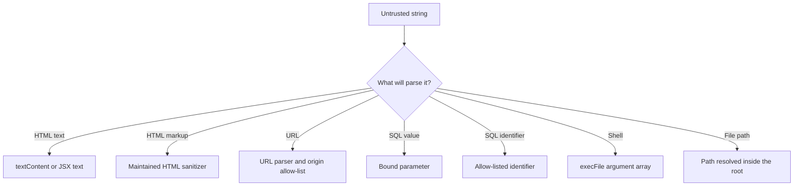

# User Input Sanitization in JavaScript: Practical and Safe Patterns

User input is untrusted by default. Whether it comes from a form, a URL, a file name, or an API request, the characters
are not the problem. The problem is a **sink** that parses those characters as code or as structure: HTML, a URL, a SQL
statement, a shell command, or a file path.

This post maps that problem for JavaScript and TypeScript. It separates validation, sanitization, and encoding, then
shows a defensive pattern for each common sink. A template literal does not make any of this safer. It only
concatenates strings.

## Quick start

The usual browser case is HTML text. Encode the five characters that start markup or entities. This is output encoding
for one context, not a general sanitizer, and not a validator.

```ts
function escapeHtml(input: string): string {
    return input
        .replaceAll("&", "&amp;")
        .replaceAll("<", "&lt;")
        .replaceAll(">", "&gt;")
        .replaceAll('"', "&quot;")
        .replaceAll("'", "&#39;");
}

console.log(escapeHtml(`Tom & Jerry <3 "quotes" 'ok'>`));
```

Result:

```text
Tom &amp; Jerry &lt;3 &quot;quotes&quot; &#39;ok&#39;&gt;
```

Replace `&` first. The other replacements contain `&`. If you encode `<` before `&`, a later pass turns `&lt;` into
`&amp;lt;` and the reader sees the entities as text. Prefer `&#39;` for the apostrophe. `&apos;` is an XML name; HTML
output encoding uses the numeric form.

If you have a DOM node, skip the helper and assign `textContent`. The browser treats the string as text. In React and
other frameworks that escape by default, put the string in a text node and do not pre-encode it.

## Sanitization checklist

- **Name the sink first.** HTML text, an `href`, a SQL value, a shell argument, and a file path need different controls.
- **Validate on the server** with a type, a length, and an allow-list. Client checks are feedback for the person
  filling in the form.
- **Normalize before the rules run.** Trim, canonicalize Unicode, and decide case. That is not sanitizing.
- **Encode at the output**, once, for that context. Or use an API that keeps data out of the code string.
- **Sanitize active formats with a maintained library** when you must accept HTML. Do not write a tag stripper.
- **Add a browser safety net** with Content Security Policy, and Trusted Types where you can enforce them.

## Validation vs sanitization vs encoding

These are different jobs. Most systems need all three, and they fail in different ways when you swap them.

| Job | Question it answers | What you get back |
| --- | --- | --- |
| Validation | Is this acceptable? | The original value, or a rejection |
| Normalization | What is the canonical form? | A trimmed, cased, or Unicode-normalized string |
| Sanitization | Which parts of this active format are allowed? | A lossy subset, such as HTML with tags removed |
| Encoding | How do I represent this data in this sink? | The same data, safe for that one context |

Validation does not make a string safe to concatenate into HTML or SQL. Encoding does not mean the value is an email, a
positive integer, or a host you trust. A sanitizer written for HTML does nothing for a shell command.

Normalize first so the rules see a stable string: `trim()`, `normalize("NFC")`, and case-folding where the domain
ignores case. Store or process that canonical value. Encode later, at the sink. If you HTML-encode before you save to
the database, the JSON API, the email, and the HTML page each need a different encoding, and the HTML page will encode
a second time.

Client-side checks are still worth writing. They belong next to the form, as in the
[events chapter](./beginners-guide/09-events.mdx). Anyone can send a request that skips the form, so the server repeats
the validation. The [error handling guide](./javascript-error-handling.md) covers how to return a safe message without
echoing the raw value.

## Match the control to the sink



| Sink | Use | Do not use for untrusted data |
| --- | --- | --- |
| HTML text | `textContent`, `createTextNode`, JSX text | `innerHTML`, `outerHTML`, `insertAdjacentHTML`, `document.write`, `srcdoc` |
| HTML you must keep | DOMPurify (or a server equivalent) with a tight allow-list | A regular expression that deletes tags |
| Quoted HTML attribute | `escapeHtml`, and quote the attribute | Event-handler attributes, `style`, unparsed `href` or `src` |
| URL | `URL` plus an allow-list of protocols and origins | `encodeURIComponent` on a whole URL |
| JSON inside `<script>` | `JSON.stringify`, then escape `<`, `>`, and `&` | String concatenation into a script |
| SQL value | A placeholder bound by the driver | A template literal of SQL |
| SQL identifier | An allow-list that maps to names you wrote | A placeholder (they bind values, not table or column names) |
| Shell | `execFile` with an argument array and `shell: false` | `exec`, or `shell: true` |
| File path | A file-name allow-list, or a resolved path that stays inside a root | `path.join` alone, or `startsWith(root)` |

These APIs also parse strings as code. Keep untrusted data out of them: `eval`, `new Function`, and `setTimeout` or
`setInterval` when the first argument is a string.

## Render text safely

In the browser, the default is to render text, not HTML.

```ts
const userInput = "<b>Hi</b>";
const safe = document.createElement("span");
safe.textContent = userInput;

console.log(safe.textContent);
```

Result:

```text
<b>Hi</b>
```

The brackets are visible characters. They do not create an element.

On this site, pages are React 19. JSX text is already encoded:

```tsx
export function Comment({ userText }: { userText: string }) {
    return <p>{userText}</p>;
}
```

Do not run `escapeHtml` before passing `userText`. React encodes it, and a second pass shows `&amp;lt;` to the reader.
The sink in React is `dangerouslySetInnerHTML`. Use it only for HTML that a sanitizer already produced for an HTML
context. MDX on this site compiles to JavaScript, so it is for pages you author, not for content submitted by readers.

Vue, Svelte, and Angular also escape text interpolations. The bug is the escape hatch (`v-html`, `{@html}`,
`[innerHTML]`), not the text binding.

## When you must build HTML, encode for that context

`escapeHtml` is the right tool when you assemble an HTML string and a human should see the input as text. It is the
wrong tool when you want to keep a subset of tags. That is sanitization, covered later.

For a double-quoted attribute, the same helper is enough, because it encodes quotes as well as markup. Always emit the
quotes.

```ts
const title = escapeHtml(`hello "world"`);
const html = `<span title="${title}">${escapeHtml("Tom & Jerry")}</span>`;

console.log(html);
```

Result:

```text
<span title="hello &quot;world&quot;">Tom &amp; Jerry</span>
```

A backtick is not special in an HTML attribute. Quoting the attribute, and encoding the five characters above, is what
matters. Do not place user input in an event-handler attribute, a `style` attribute, or a `javascript:` URL. Encoding
for HTML text does not make those contexts safe.

Style values should be an allow-list, then assigned through the DOM property so you are not building a declaration
block:

```ts
const allowedColors = new Set(["navy", "maroon", "black"]);

function applyUserColor(element: HTMLElement, color: string): void {
    if (!allowedColors.has(color)) return;
    element.style.color = color;
}

console.log(allowedColors.has("navy"));
console.log(allowedColors.has("blue"));
```

Result:

```text
true
false
```

HTML-encoding a string and dropping it into `href` or `src` does not choose a safe protocol. Parse the URL, then
encode. The URL section below is that control.

### JSON inside a script element

`JSON.stringify` is the encoder for a JSON string. Inside an HTML `<script>` element it is not quite enough. A `<`
can be parsed as markup, and the line separators U+2028 and U+2029 can break the surrounding script. Escape them to
JSON unicode escapes. The parsed value stays the same.

```ts
function jsonForHtmlScript(value: unknown): string {
    return JSON.stringify(value)
        .replaceAll("<", "\\u003c")
        .replaceAll(">", "\\u003e")
        .replaceAll("&", "\\u0026")
        .replaceAll("\u2028", "\\u2028")
        .replaceAll("\u2029", "\\u2029");
}

console.log(jsonForHtmlScript({ note: "a < b & c" }));
```

Result:

```text
{"note":"a \u003c b \u0026 c"}
```

This is still the wrong tool for SQL, shell, and file paths. Context is the whole point. The
[OWASP XSS Prevention Cheat Sheet](https://cheatsheetseries.owasp.org/cheatsheets/Cross_Site_Scripting_Prevention_Cheat_Sheet.html)
lists the contexts separately if you need the full matrix.

## Validate with allow-lists

Allow-lists are safer than trying to block every unwanted input. For usernames, keep the rule boring and anchored to
the whole string.

```ts
function isValidUsername(input: string): boolean {
    return /^[a-z0-9_]{3,20}$/i.test(input);
}

console.log(isValidUsername("luca_nerlich"));
```

Result:

```text
true
```

The `^` and `$` matter. Without them, the pattern can match a slice of a longer string. This particular pattern is
linear. Avoid validators with a quantifier nested around another quantifier over the same input: those can run long
enough to tie up a server. If a username should ignore surrounding space, trim and `normalize("NFC")` before calling
the check. Do that outside the test so the validator still means "this exact string matches."

A block-list of words or tags fails open. A new string that is not on the list is accepted.

## Normalize before validating

Normalization makes the rules stable. It does not prove the value is safe to render.

Email is the example people overfit. Lowercasing the whole address is a convenience, and it is not quite right: the
domain is case-insensitive, and the local part is case-sensitive in the spec. This helper trims, lowercases the
domain, and rejects shapes that cannot be a normal address. It is not a full parser, it does not convert
internationalized domains to punycode, and it does not prove the mailbox exists. For mail you actually send, hand the
normalized string to a maintained parser or to your provider.

```ts
function normalizeEmail(input: string): string | null {
    const trimmed = input.trim().normalize("NFC");
    if (trimmed.length === 0 || trimmed.length > 254) return null;
    const at = trimmed.indexOf("@");
    if (at <= 0 || at !== trimmed.lastIndexOf("@")) return null;
    const local = trimmed.slice(0, at);
    const domain = trimmed.slice(at + 1).toLowerCase();
    if (local.length > 64 || domain.length > 253) return null;
    if (!domain.includes(".") || domain.startsWith(".") || domain.endsWith(".")) return null;
    if (domain.includes("..")) return null;
    return `${local}@${domain}`;
}

console.log(normalizeEmail("  USER@EXAMPLE.COM  "));
console.log(normalizeEmail("not-an-email"));
```

Result:

```text
USER@example.com
null
```

## Numeric input

`Number("1e2")` is `100`, `Number(" 42 ")` is `42`, and `Number("")` is `0`. `parseInt("42abc", 10)` returns `42` and
stops. None of those are what you want for an identifier. Parse integers with an anchored pattern, then confirm the
value is a safe integer.

```ts
function toPositiveInt(input: string): number | null {
    if (!/^[1-9]\d{0,8}$/.test(input)) return null;
    const value = Number(input);
    if (!Number.isSafeInteger(value)) return null;
    return value;
}

console.log(toPositiveInt("42"));
console.log(toPositiveInt("1e2"));
console.log(toPositiveInt("42abc"));
```

Result:

```text
42
null
null
```

Nine digits stay inside `Number.MAX_SAFE_INTEGER`. Widen the pattern only if you move to `BigInt` on purpose.
Coercion belongs in a function like this one. Do not hide it inside a type guard that claims to check a number.

## Backend: validate request data

On the server, reject the request before the value reaches a sink. Treat the body as `unknown` until a guard narrows
it. Arrays are objects in JavaScript, so exclude them. Require a real number for `age`; a numeric string is a
different type and should fail this guard. Bounds are a product rule you choose and then enforce.

Parsed JSON has the same shape problem. Validate it before use, as the
[JSON parsing guide](./json-parsing-guide.md) covers, and do not log passwords, tokens, or other secrets that arrived
in the body. Log the field name and a stable error code.

```ts
type CreateUserInput = { name: string; age: number };

function validateCreateUser(input: unknown): CreateUserInput | null {
    if (typeof input !== "object" || input === null || Array.isArray(input)) return null;
    const value = input as Record<string, unknown>;
    if (typeof value.name !== "string") return null;
    const name = value.name.trim().normalize("NFC");
    if (name.length < 1 || name.length > 80) return null;
    if (/[\u0000-\u001F\u007F]/.test(name)) return null;
    if (typeof value.age !== "number" || !Number.isInteger(value.age)) return null;
    if (value.age < 0 || value.age > 130) return null;
    return { name, age: value.age };
}

const candidate = { name: "Ada", age: 36 };
console.log(validateCreateUser(candidate));
```

Result:

```text
{ name: "Ada", age: 36 }
```

`trim()` runs before the control-character test, so surrounding whitespace is removed and a newline that remains in
the middle is rejected.

Once more than one handler needs the same rules, put them in a schema library (Zod, Valibot, ArkType, or the validator
your framework already ships). Hand-rolled guards drift. The library does not remove the need to encode at the sink.

## Encode for URLs

Build URLs with `URL` and `URLSearchParams`. They encode query values for you. Use `encodeURIComponent` when you are
inserting one component, such as a path segment, into a string yourself. `encodeURI` is a different function: it
leaves reserved characters in place and assumes you already have a whole URL. Neither function checks the protocol or
the host.

```ts
const url = new URL("https://example.com/search");
url.searchParams.set("q", "cats & dogs");

console.log(url.href);
console.log(`https://example.com/tags/${encodeURIComponent("cats & dogs")}`);
```

Result:

```text
https://example.com/search?q=cats+%26+dogs
https://example.com/tags/cats%20%26%20dogs
```

`URLSearchParams` uses `+` for spaces, which is correct for a query. `encodeURIComponent` uses `%20`, which is what
you want in a path segment. Do not run `encodeURIComponent` on a full URL. It encodes `https://` into a single path
segment.

When the user supplies a whole URL (a profile link, a redirect target), parse it and allow-list the protocol. Reject
embedded credentials. If the link must stay on your site, compare `origin` to an origin you chose. An absolute input
ignores the base URL, which is how a redirect target leaves your site.

```ts
function toAllowedOriginUrl(input: string, base: string, allowedOrigin: string): URL | null {
    let url: URL;
    try {
        url = new URL(input, base);
    } catch {
        return null;
    }
    if (url.protocol !== "https:" && url.protocol !== "http:") return null;
    if (url.username !== "" || url.password !== "") return null;
    if (url.origin !== allowedOrigin) return null;
    return url;
}

const base = "https://example.com/app/";
const origin = "https://example.com";
console.log(toAllowedOriginUrl("/docs", base, origin)?.href ?? "rejected");
console.log(toAllowedOriginUrl("https://elsewhere.example/docs", base, origin)?.href ?? "rejected");
```

Result:

```text
https://example.com/docs
rejected
```

Compare hostnames on `url.hostname`, which is ASCII (punycode for internationalized names). A string compare against
the raw input will not do that. Allow `http:` only when you mean to. Add schemes such as `mailto:` in a separate
helper that checks that scheme and nothing else.

## SQL

Bind values. The driver sends the statement and the values separately, and the database does not parse those values as
SQL. The placeholder token depends on the driver (`$1` for `node-postgres`, `?` for `mysql2`). The split is the same.

```ts
type SqlQuery = { text: string; values: readonly unknown[] };

function userByEmail(email: string): SqlQuery {
    return {
        text: "SELECT id, name FROM users WHERE email = $1",
        values: [email],
    };
}

console.log(userByEmail("ada@example.com"));
```

Result:

```text
{ text: "SELECT id, name FROM users WHERE email = $1", values: [ "ada@example.com" ] }
```

Pass `text` and `values` to the driver. Do not concatenate after this point. An ORM does not change the rule: use its
parameterized API. A method that accepts a finished SQL string is still a sink.

Placeholders bind values, not identifiers. Table names, column names, and `ORDER BY` targets cannot be parameters.
Map an allow-listed key to a column name that appears in your source:

```ts
const SORT_COLUMNS: Record<string, string> = {
    name: "name",
    newest: "created_at",
};

function listUsers(sortKey: string): SqlQuery | null {
    if (!Object.hasOwn(SORT_COLUMNS, sortKey)) return null;
    const column = SORT_COLUMNS[sortKey];
    return {
        text: `SELECT id, name FROM users ORDER BY ${column}`,
        values: [],
    };
}

console.log(listUsers("newest"));
```

Result:

```text
{ text: "SELECT id, name FROM users ORDER BY created_at", values: [] }
```

`Object.hasOwn` keeps the lookup off the prototype chain, so a key you did not write cannot select `constructor` or
another inherited property. `column` is then a string from the map. If the user should not control a `LIKE` pattern,
escape `%` and `_` in the value and still bind the result. Binding alone leaves the wildcards in place.

## Commands

On the server, run a fixed program with an argument array. `execFile` does not invoke a shell unless you set
`shell: true`. `child_process.exec` does the opposite: it runs a shell, so metacharacters in the string are shell
syntax. Pass `shell: false` in the snippet so the choice is visible.

```ts
import { execFile } from "node:child_process";

function showGitStatus(): void {
    execFile("git", ["status", "--porcelain"], { shell: false }, (error, stdout) => {
        if (error) {
            const code = "code" in error ? error.code : "unknown";
            console.error("git status failed", code);
            return;
        }
        console.log(stdout);
    });
}
```

The program name is a constant. Each argument is one array entry, not a fragment of a command line. If a user value
has to become an argument, check it against an allow-list, then pass that exact string as one element. Do not build a
shell string with a template literal. Even with `shell: false`, an untrusted program name is "run this binary."
Allow-list the executable as well as the arguments.

The callback above logs a status code, not a reconstructed command. Failed commands can include paths and arguments in
`error.message`. Treat that as sensitive if those values are.

## File paths

Prefer a file name over a path. If the user is choosing an object id, accept only a name you would put in one
directory: no separators, no empty name, no dotfiles unless you have a reason.

```ts
function safeFileName(fileName: string): string | null {
    if (fileName.includes("\0")) return null;
    if (fileName.includes("/") || fileName.includes("\\")) return null;
    if (fileName === "." || fileName === ".." || fileName.startsWith(".")) return null;
    if (!/^[\w.-]{1,120}$/.test(fileName)) return null;
    return fileName;
}

console.log(safeFileName("photo.jpg"));
console.log(safeFileName("a/photo.jpg"));
```

Result:

```text
photo.jpg
null
```

`\w` here is ASCII letters, digits, and underscore. Add characters you expect (a space, for example) on purpose. Do
not drop the separator checks to make display names work.

When you do need a relative path, resolve it and require the result to stay inside a root. `path.join` and
`path.resolve` do not do that check. A `startsWith(root)` test is wrong as well: the string `/var/app/data-backup`
starts with `/var/app/data`. Compare a relative path, and treat `..` as a segment (`..` followed by the platform
separator) so a file named `..hidden` is still allowed.

```ts
import path from "node:path";

function resolveInside(root: string, userPath: string): string | null {
    if (userPath.includes("\0") || path.isAbsolute(userPath)) return null;
    const base = path.resolve(root);
    const target = path.resolve(base, userPath);
    const relative = path.relative(base, target);
    if (relative === "" || relative === ".." || relative.startsWith(`..${path.sep}`)) return null;
    if (path.isAbsolute(relative)) return null;
    return target;
}

console.log(resolveInside("/var/app/uploads", "photo.jpg"));
console.log(resolveInside("/var/app/uploads", ".."));
console.log(resolveInside("/var/app/uploads", "..hidden"));
```

Result (POSIX):

```text
/var/app/uploads/photo.jpg
null
/var/app/uploads/..hidden
```

On Windows the same calls use backslashes and a drive letter. `path.sep` keeps the `..` check on that platform. An
empty relative path is the root itself (for example an input of `.`), and this helper rejects it so the caller gets a
file inside the root rather than the root.

This check is lexical. `path.resolve` does not follow symlinks. If the root can contain a link that points outside it,
resolve `fs.realpath` on the root and on the parent of the target, then run the same relative check before you read or
write. There is still a gap between the check and the use. For a single directory of uploads, `safeFileName` plus
`path.join(root, fileName)` avoids that class of path entirely.

## Rich text

If you allow markup, use a maintained HTML sanitizer at the boundary where HTML is parsed. DOMPurify is the usual
choice in the browser. Keep the allow-list tight, limited to tags and attributes your editor actually stores. The
default tag list includes SVG and MathML. An explicit `ALLOWED_TAGS` list replaces that default, which is how you drop
them.

```ts
import DOMPurify from "dompurify";

function sanitizeRichText(dirtyHtml: string): string {
    return DOMPurify.sanitize(dirtyHtml, {
        ALLOWED_TAGS: ["p", "strong", "em", "ul", "ol", "li", "a", "code"],
        ALLOWED_ATTR: ["href", "title"],
        ALLOW_DATA_ATTR: false,
        ALLOW_ARIA_ATTR: false,
    });
}
```

`ADD_TAGS` adds to the default list, which is a wider policy than most editors need. Do not set `USE_PROFILES` in the
same call. The profile overrides `ALLOWED_TAGS`, and the tight list is ignored. `ALLOW_DATA_ATTR` and
`ALLOW_ARIA_ATTR` default to true, so turn them off when `ALLOWED_ATTR` should be the whole attribute list. Leave the
default URL protocol checks on. Setting `ALLOWED_URI_REGEXP` or `ALLOW_UNKNOWN_PROTOCOLS` replaces those checks, and a
loose pattern puts unsafe URLs back into `href`. Do not add `style` to `ALLOWED_ATTR`. Sanitized HTML is safe for an
HTML context only. Do not concatenate it into a script, a style sheet, or a URL.

Do not call `sanitize()` from inside a DOMPurify hook. The function is not re-entrant: a nested call can replace the
configuration for the rest of the document and widen a strict allow-list back to the default.

Do not edit the sanitized string afterward. A later template pass can put unsafe markup back. Sanitize at render time
even if you also sanitized before saving, because the policy and the library both change.

DOMPurify needs a DOM. In the browser, the import above is enough. On Node, pass a current jsdom window. Older
jsdom releases have had parser bugs that a correct sanitizer still inherits. DOMPurify's maintainers do not consider
happy-dom a safe DOM for this job. Install with pnpm in the application that renders the HTML (this documentation
site does not depend on either package):

```bash
pnpm add dompurify
pnpm add jsdom
```

```ts
import { JSDOM } from "jsdom";
import DOMPurify from "dompurify";

const purify = DOMPurify(new JSDOM("").window);
```

Call `purify.sanitize` with the same options as the browser helper.

A regular expression that deletes tags is not a substitute. HTML is not a regular language, and the browser's parser
will accept forms your pattern has not imagined.

In React, the sanitized string is the one case for the HTML sink:

```tsx
export function RichComment({ userHtml }: { userHtml: string }) {
    return <div dangerouslySetInnerHTML={{ __html: sanitizeRichText(userHtml) }} />;
}
```

## Content Security Policy

A Content Security Policy tells the browser which sources may load scripts, styles, and other resources. For XSS, its
value is blocking script execution when an unsafe sink slips through review. It does not replace validation,
sanitization, or output encoding.

This site is a static Docusaurus build. A prebuilt HTML file cannot carry a fresh nonce on every response. Keep
scripts in files and allow those files with `script-src 'self'`, which is the starter policy in the
[Nginx deploy chapter](./beginners-guide/12-deploy-vps-nginx.md). That chapter also shows why `style-src` sometimes
allows inline styles while `script-src` must not.

A dynamic application that can set a header per response should use a nonce and `strict-dynamic` instead of trusting
every script on an origin. Host allowlists still allow any script those hosts serve.

```http
Content-Security-Policy: script-src 'nonce-{RANDOM}' 'strict-dynamic'; object-src 'none'; base-uri 'none'; frame-ancestors 'none'; form-action 'self'
```

`{RANDOM}` is a placeholder, not the header value. Generate at least 128 bits on the server for that response, with
`crypto.randomBytes`, and put the same value on each trusted `<script>` element. Do not generate the nonce in page
JavaScript, and do not reuse it. Browsers that understand `strict-dynamic` ignore a host allowlist in `script-src` and
trust scripts loaded by a nonce-bearing script. That trust propagates, so a trusted script should not load code from a
URL the application does not control.

Do not add `'unsafe-inline'` to `script-src`. It allows inline scripts and event-handler attributes. Do not add
`'unsafe-eval'` to satisfy a library if you can avoid it. `object-src 'none'` and `base-uri 'none'` close two classic
holes. `frame-ancestors` limits who may embed the page. It is clickjacking control, not XSS control, and it belongs in
the same header.

Roll the policy out as report-only until the reports are quiet, then switch to the enforcing header:

```http
Content-Security-Policy-Report-Only: script-src 'nonce-{RANDOM}' 'strict-dynamic'; object-src 'none'; base-uri 'none'; frame-ancestors 'none'; form-action 'self'; report-to csp-endpoint
```

`report-to` names an endpoint group. You also need a `Reporting-Endpoints` header whose group name matches.
`report-uri` is the older fallback. The
[OWASP CSP Cheat Sheet](https://cheatsheetseries.owasp.org/cheatsheets/Content_Security_Policy_Cheat_Sheet.html)
covers both the strict policy and the reporting setup.

## Trusted Types

Trusted Types reduce DOM XSS by making sinks such as `innerHTML` accept a trusted object instead of a plain string.
You opt in with CSP. The API is Baseline as of 2026 (Chromium for years, Safari 26, Firefox 148). Enforcement is still
something you turn on, and older browsers still need the sanitized string. Check
[MDN's Trusted Types page](https://developer.mozilla.org/en-US/docs/Web/API/Trusted_Types_API) before you treat
enforcement as required for every visitor.

Create one named policy at startup. `createPolicy` throws if you register the same name twice. A `default` policy
also exists; a named policy makes the call sites obvious.

Inside `createHTML`, DOMPurify must return a string, so set `RETURN_TRUSTED_TYPE: false`. The policy method then wraps
that string. The other shape is to call `sanitize` with `RETURN_TRUSTED_TYPE: true` and allow DOMPurify's own policy
name, `dompurify`, in the CSP `trusted-types` directive. Use one of those shapes. If `createHTML` itself calls
`sanitize` with `RETURN_TRUSTED_TYPE: true`, the callback returns a trusted object where a string is required.

```http
Content-Security-Policy: require-trusted-types-for 'script'; trusted-types app-html
```

```ts
type TrustedHtmlPolicy = { createHTML: (input: string) => TrustedHTML };

declare const DOMPurify: {
    sanitize(input: string, config?: { RETURN_TRUSTED_TYPE?: boolean }): string;
};

function createHtmlPolicy(): TrustedHtmlPolicy | null {
    const factory = window.trustedTypes;
    if (!factory) return null;
    return factory.createPolicy("app-html", {
        createHTML: (input: string) => DOMPurify.sanitize(input, { RETURN_TRUSTED_TYPE: false }),
    });
}

const htmlPolicy = createHtmlPolicy();

function renderUserHtml(content: Element, userHtml: string): void {
    const sanitized = htmlPolicy
        ? htmlPolicy.createHTML(userHtml)
        : DOMPurify.sanitize(userHtml, { RETURN_TRUSTED_TYPE: false });
    // The DOM setter accepts TrustedHTML. TypeScript still types innerHTML as string.
    // Do not String() the value: enforcement rejects a plain string.
    content.innerHTML = sanitized as string;
}

const content = document.querySelector("#content");
if (content) {
    renderUserHtml(content, "<p>Hello</p>");
}
```

The policy name in `createPolicy` has to appear in the `trusted-types` directive, or the browser refuses to create it.
Combine these directives with the rest of your CSP in one header when you deploy.

## Common pitfalls

- **Calling `trim()` sanitization.** It is normalization. The sink is still there.
- **Encoding for the wrong context.** HTML encoding does nothing useful inside SQL, a shell string, or a file path.
- **Encoding twice**, or encoding before a framework text binding. Readers see the entities.
- **Encoding once and reusing it everywhere.** Store the canonical value. Encode at each sink.
- **Building HTML with `innerHTML` or `insertAdjacentHTML`.** Use `textContent`, or a sanitizer plus Trusted Types.
- **Stripping tags with a regular expression.** Use a sanitizer.
- **Trusting the client check** and skipping the server.
- **Parsing integers with `Number` or `parseInt`.** They accept more than digits.
- **Running `encodeURIComponent` on a whole URL**, or HTML-encoding a string into `href`.
- **Checking paths with `startsWith(root)`.** `/var/app/data-backup` starts with `/var/app/data`.
- **Using `exec` or `shell: true`** with any string you assembled.
- **Concatenating SQL**, including an `ORDER BY` column taken from the request.
- **Editing sanitized HTML** before it reaches the sink.
- **Copying `'nonce-{RANDOM}'` into a real header**, or generating the nonce in the browser.
- **Calling `String()` on a TrustedHTML value** before assigning it.
- **Logging raw input** that may contain credentials, tokens, or personal data.

## Best practices

- **Validate on every boundary** that accepts input, especially the server.
- **Keep the rules in one schema** so handlers do not drift.
- **Allow-list** usernames, ids, file names, URL origins, commands, and SQL identifiers.
- **Encode at the sink for that sink**: HTML text, quoted attributes, URL components, JSON in a script, bound SQL.
- **Sanitize HTML with a library**, and keep SVG, MathML, and URL exceptions out unless you need them.
- **Ship CSP** as a second layer. Prefer nonces and `strict-dynamic` when the app can set them per response.
- **Test the guards** with values that should pass and values that should fail: wrong types, empty strings, boundary
  lengths, and strings that are meaningful in a different sink.

## FAQ

### What is the difference between validation and sanitization?

Validation accepts or rejects. Sanitization changes the data to a subset that matches a policy, which is lossy and
specific to one format. Encoding is a third job: it represents the same data so a sink treats it as data.
`escapeHtml` encodes. `trim()` normalizes. `isValidUsername` validates. None of them replaces the others.

```ts
const raw = "  luca_nerlich  ";
const normalized = raw.trim().normalize("NFC");
console.log(isValidUsername(normalized));
console.log(escapeHtml(normalized));
```

Result:

```text
true
luca_nerlich
```

### How do I prevent XSS in JavaScript?

Render untrusted text with `textContent` or a framework text binding. When the product must store HTML, sanitize with
a maintained library and a small allow-list, and do not modify the result. Encode for any other context you
interpolate into. Use CSP, and Trusted Types if you assign to HTML sinks, so a missed call site fails closed.

```ts
const input = "<b>Hi</b>";
const safeText = document.createTextNode(input).textContent;
console.log(safeText);
```

Result:

```text
<b>Hi</b>
```

### Should I sanitize on the backend if I already do it on the frontend?

Yes. The frontend check is there so the form can explain a problem. The backend check is the security boundary,
because the client can send a body the form would never build. This guard rejects a numeric string rather than
coercing it:

```ts
console.log(validateCreateUser({ name: "Ada", age: "36" }));
```

Result:

```text
null
```

### Should I encode before I save to the database?

No. Validate and normalize on the way in. Encode on the way out, for the sink you are writing to. Save sanitized HTML
only when you really store HTML, and sanitize again at render time. HTML-encoding before storage breaks every
non-HTML consumer and tends to get encoded a second time in the page.

## Summary

Name the sink, then pick the control that matches it. Validate with types, bounds, and allow-lists. Normalize so those
rules see a stable value. Encode at the output, or use an API that does not parse your string as code: `textContent`,
a bound SQL parameter, `execFile` with a fixed program, a file name with no separators. Sanitize HTML only with a
maintained library. CSP and Trusted Types are the layer that catches a sink you missed. The frontend check is not that
layer.

## Further reading

- [OWASP Input Validation Cheat Sheet](https://cheatsheetseries.owasp.org/cheatsheets/Input_Validation_Cheat_Sheet.html)
- [OWASP XSS Prevention Cheat Sheet](https://cheatsheetseries.owasp.org/cheatsheets/Cross_Site_Scripting_Prevention_Cheat_Sheet.html)
- [OWASP SQL Injection Prevention Cheat Sheet](https://cheatsheetseries.owasp.org/cheatsheets/SQL_Injection_Prevention_Cheat_Sheet.html)
- [OWASP OS Command Injection Defense Cheat Sheet](https://cheatsheetseries.owasp.org/cheatsheets/OS_Command_Injection_Defense_Cheat_Sheet.html)
- [OWASP Content Security Policy Cheat Sheet](https://cheatsheetseries.owasp.org/cheatsheets/Content_Security_Policy_Cheat_Sheet.html)
- [MDN: Trusted Types API](https://developer.mozilla.org/en-US/docs/Web/API/Trusted_Types_API)
