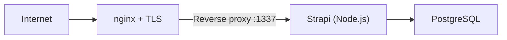

# Configuration & Deployment

Our blog CMS is feature-complete. This chapter is a short deploy checklist for that project.
The full recipes - environment config, PostgreSQL, Docker, PM2, nginx, and HTTPS --
live in one place: [Configuration and Deployment](/strapi/configuration-and-deployment).
That page also has a production hardening checklist; OS-level steps (firewall, SSH, Fail2Ban)
belong in your VPS/Linux hardening guides, not duplicated here.

Use the reference as the source of truth. Follow the steps below in order, opening the linked
sections when you need the commands or file contents.

## Deployment architecture

## Walkthrough

1. **Environment-based config** - create `config/env/production/` overrides and a production
   `.env`. See [Environment-based configuration](/strapi/configuration-and-deployment#environment-based-configuration)
   and [Environment variables](/strapi/configuration-and-deployment#environment-variables-env).
   Use Strapi's own SSL flag name: `DATABASE_SSL_REJECT_UNAUTHORIZED`.
2. **PostgreSQL** - switch the production database client off SQLite. See
   [PostgreSQL (recommended for production)](/strapi/configuration-and-deployment#postgresql-recommended-for-production).
3. **Ship the app** - build the admin panel on the server (or in CI), then run with
   `NODE_ENV=production`. Docker users can start from
   [Docker deployment](/strapi/configuration-and-deployment#docker-deployment).
4. **Keep it running** - use PM2 or systemd. See
   [PM2 deployment (VPS)](/strapi/configuration-and-deployment#pm2-deployment-vps).
5. **Terminate TLS** - put nginx in front and obtain certificates. See
   [nginx reverse proxy and HTTPS](/strapi/configuration-and-deployment#nginx-reverse-proxy-and-https).
6. **Harden and back up** - walk the
   [Production hardening checklist](/strapi/configuration-and-deployment#production-hardening-checklist)
   and set up the
   [Backup strategy](/strapi/data-import-export-migration#backup-strategy)
   before you call the deploy done.

## Acceptance check

After the walkthrough:

- Exactly one page owns the full deployment recipes: [Configuration and Deployment](/strapi/configuration-and-deployment).
- Env var names match that page (including `DATABASE_SSL_REJECT_UNAUTHORIZED`).
- The blog is reachable over HTTPS behind a reverse proxy, with PostgreSQL and a process manager.

## Where to go from here

- [Content Modeling Patterns](/strapi/content-modeling-patterns)
- [GraphQL Customization](/strapi/graphql-customization)
- [Plugin Development](/strapi/plugin-development)
- [Performance and Caching](/strapi/performance-and-caching)
- [Testing Strapi Applications](/strapi/testing-strapi-applications)
